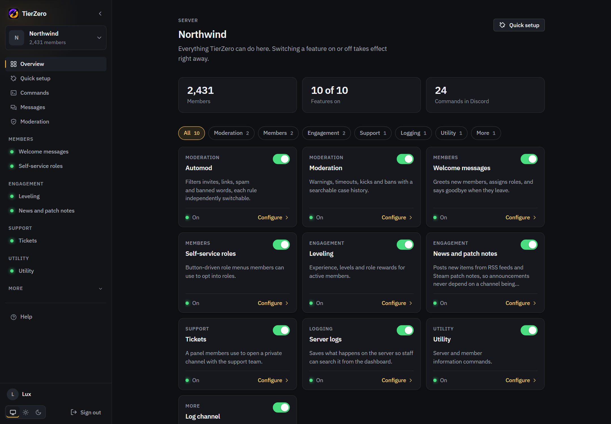

# TierZero

A Discord bot you host yourself, with a web dashboard to configure it.

It covers moderation, automod, tickets, logging and leveling, which most bots charge a subscription for. Everything here is free. There are no paid features.

Your server's data stays on the machine you run it on.



## Status

TierZero is in beta. Everything listed below works, but settings and the database can still change between releases, and each [release](https://github.com/Luxrrrr/TierZero/releases) says what changed. If you're going to build on the internals, read [docs/architecture.md](docs/architecture.md) first.

## Requirements

- A computer to run it on. Your own PC works, but the bot is offline whenever that PC is off or asleep, so an old PC, a Raspberry Pi or a cheap rented server that stays on is better for a server you actually use.
- Docker, or Node 20 and pnpm if you want to run it from source.
- A Discord application of your own. Both install guides cover creating it.
- The Manage Server permission on the Discord server the bot is joining. It's one of Discord's own permissions, set on roles under Server Settings, and the server owner has it. Discord requires it to add a bot, and the dashboard only lists servers where you have it.

## Install

| Guide | Use it if |
| --- | --- |
| [Quick install](docs/install.md) | You're comfortable in a terminal. Covers the Discord setup, running behind a domain, updating, backups and troubleshooting. |
| [Beginner guide](docs/install-beginner.md) | You've never done this. Every step is spelled out and every term is explained. |

The short version, with Docker:

```
git clone https://github.com/Luxrrrr/TierZero.git
cd TierZero
cp .env.example .env
mkdir -p data
```

Fill in `.env` with your Discord application's values, then:

```
docker compose up -d
```

Open http://localhost:8080 and sign in with Discord. The owner of the install is the Discord account that owns the bot's application, who can use the moderation area on every server and decides who else can.

## Features

Every feature is a module and every module starts off. You switch them on and off per server from the dashboard, and the change applies immediately, with no restart. Single commands can also be hidden, or limited to certain roles and channels.

| Feature | What it does |
| --- | --- |
| Moderation | Warn, timeout, kick, ban and temporary bans. Each action gets a numbered case, and role hierarchy is checked first. |
| Moderation dashboard | Member records with staff notes, actions from a member's profile, an exportable action log, statistics and an audit trail of staff changes. You control who has access, separately from Discord's Manage Server permission. Warns and timeouts can be removed from a record while the history stays. Staff can also act from Discord's right-click menu on a member or a message. It also covers reason presets, escalation rules such as three warns leading to a timeout, warns that expire, channel lockdown and bulk actions for raids, and ban appeals. |
| Automod | Invites, links, capitals, repeated text, mention limits, banned words and rate limiting. Seven rules, each with its own action and exemptions. All off by default. |
| Tickets | Panels with several ticket types, each with its own handlers, questions and rules. A ticket is a private channel or thread. Staff can work tickets from the dashboard and reply from there. Transcripts are stored and look like Discord, and tickets have ratings, auto-close and saved replies. |
| Welcome messages | Greetings, farewells and roles on join. |
| Role menus | Members pick their own roles from buttons or a dropdown. You post and update a menu from the dashboard. |
| Audit logging | Edits, deletions, joins, departures, nicknames, roles, channels, bans, kicks, timeouts, voice, invites, threads and emoji. Each kind has its own switch and can go to its own channel. |
| Leveling | XP for activity, role rewards and a leaderboard, with an optional public leaderboard page. No image rank cards, on purpose. |
| News and patch notes | Posts new items from RSS feeds, YouTube channels and Steam patch notes as embeds with the game's logo. For sources Discord's Follow button can't handle. |
| Utility | Server and member info. |


More detail on each is in [docs/features.md](docs/features.md).

## Docs

| Doc | Contents |
| --- | --- |
| [Quick install](docs/install.md) | Install, domains, updating, backups, troubleshooting |
| [Beginner guide](docs/install-beginner.md) | The same install, step by step |
| [Features](docs/features.md) | How each feature behaves |
| [Architecture](docs/architecture.md) | How the pieces fit together, and why |
| [Writing a module](docs/modules.md) | The module contract and settings schema |
| [Contributing](docs/contributing.md) | Dev setup, tests, and rules for the moderation records |

## License

AGPL-3.0-or-later. If you run a modified version as a service for other people, you have to publish your changes under the same license.
