# Features

## The short version

| Feature | What it does |
| --- | --- |
| Moderation | Warn, timeout, kick, ban and temporary bans, with numbered cases and role hierarchy checks. |
| Moderation dashboard | Member records, staff notes, actions from the web or Discord's right-click menu, statistics, a log of staff activity and CSV export. |
| Automod | Seven rules: invites, links, capitals, repeated text, mentions, banned words, rate limiting. |
| Tickets | Panels members use to open a private channel or thread with the right staff. |
| Welcome messages | Greetings, farewells and roles on join. |
| Verification | A button, captcha or question new members pass to get a role. |
| Role menus | Members pick their roles from buttons or a dropdown. |
| Gaming tools | Join-to-create voice channels, looking-for-group posts and scrim or tournament sign-ups. |
| Log channel | Posts edits, deletions, joins, role changes and more into a Discord channel. |
| Leveling | XP, role rewards and a leaderboard, with an optional public web page for it. No image cards. |
| News and patch notes | RSS feeds, YouTube channels and Steam patch notes, posted as embeds. |
| Message creator | Build a message or embed, save it as a template, sort templates into folders, and send it to any channel now, later or on repeat. Replace a message the bot already sent. |
| Bot messages | Every message the bot sends, found by feature or by search, each one editable. |
| Utility | Server and member info. |

Good to know:

- Every feature starts off. You switch them on per server, and it applies immediately with no restart.
- **Quick setup** in the sidebar gets a feature running with just the settings it needs.
- Moderators don't need Manage Server. The owner adds them under Moderation, then Access.
- Moderators can only use the dashboard if it's reachable from their devices. The [install guide](install.md#reaching-the-dashboard-from-other-devices) covers how.
- Only the owner can permanently delete a case or note. Anyone else's removal leaves a trace.

## In detail

Every feature is a module, and a module that's off does nothing. Most settings are optional. Leave one blank and that part stays quiet. A feature that's switched on but has nothing to do yet, such as welcome messages with no channel, shows **Needs setup** instead of **On**, with what to fill in. If the bot's role is missing a Discord permission a feature needs, that feature's tile on the server overview names it.

Keyboard shortcuts are listed on the Help page. Ctrl+B (Cmd+B on a Mac) folds the sidebar away, except while you are typing in a box. In a message's text it makes the selected text bold.

Changes on a settings page are kept until you press **Save changes** (or Ctrl+S). If you click away to another page with changes not saved, the dashboard asks whether to save them, discard them or stay. Lists of rows, such as role menu options or feeds, can be put in a different order with the arrow buttons on each row (or by dragging its number), and **Duplicate** in an open row adds a copy right after it.

- [Quick setup](#quick-setup)
- [Commands](#commands)
- [Moderation](#moderation)
- [Moderation dashboard](#moderation-dashboard)
- [Automod](#automod)
- [Welcome messages](#welcome-messages)
- [Verification](#verification)
- [Role menus](#role-menus)
- [Tickets](#tickets)
- [Log channel](#log-channel)
- [News and patch notes](#news-and-patch-notes)
- [Leveling](#leveling)
- [Gaming tools](#gaming-tools)
- [Utility](#utility)
- [Updates, changelog and what's coming](#updates-changelog-and-whats-coming)

## Quick setup

Quick setup in the sidebar asks only for the few settings a feature can't work without, one feature per screen, and switches each feature on as you save its screen. A feature that would still do nothing, such as Automod with every rule off, keeps your answers but stays off, and the screen says what it still needs. **Moderation** walks through moderation and automod together, and every feature that has a quick setup is listed on its own below it. The last screen says which features are still off or have nothing to do, and what to fill in.

Nothing is locked in. Settings it doesn't ask about keep their values, skipping a step leaves that feature as it was, and you can change anything later on the feature's own page. Features made of repeating rows get a short version: Roles asks for a first menu, and Tickets has the setup described below.

**Tickets** has a quick setup of its own, under Tickets in the sidebar. It asks where the panel goes, which roles answer, whether tickets open as private channels (and in which category) or as threads, and optionally where closed tickets are logged. It then saves your answers, turns Tickets on and posts the panel, and ends by saying whether members can open a ticket, or what still stops them. It covers the first panel and its first ticket type; more panels and types are added under Settings.

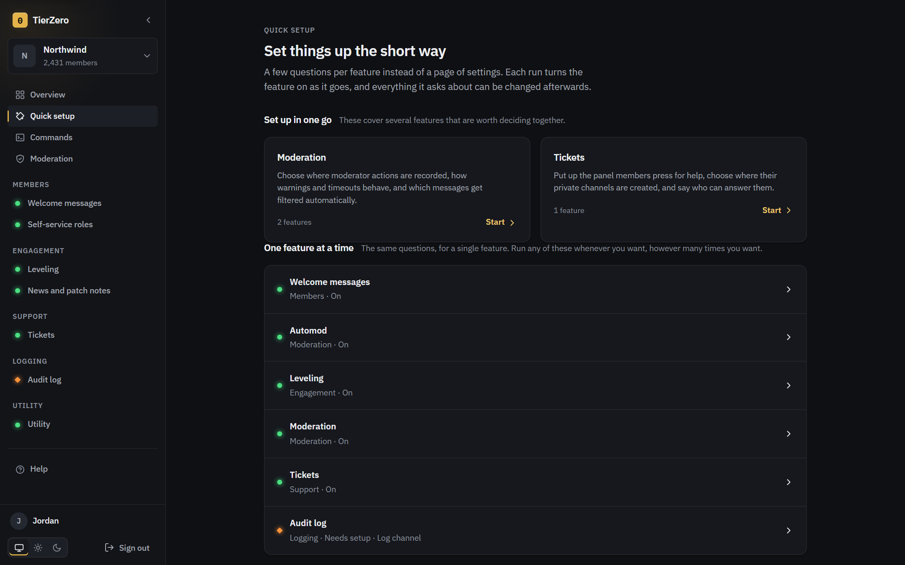

## Commands

The Commands page lists every command on the server, including the right-click entries. A command is only in Discord while its feature is on: the commands of a feature that's off are marked **Feature off**, with a button to turn the feature on, and the overview's count of commands in Discord leaves them out. Each command can be switched off, limited to certain roles, limited to certain channels, or hidden from members without a chosen permission. You can also decide whether its reply is private or public, and for /ping, /serverinfo, /userinfo, /rank, /leaderboard, /warn, /kick, /ban, /unban and /timeout, write the reply yourself with the same editor as the [Message creator](#message-creator): text, embeds, buttons, menus and variables, plus reactions on a public reply. The editor starts from what the command says now, and each command has its own variables, such as `{user}` and `{case}` for /warn. Discord can't hide a command by role, so the role list blocks use but doesn't hide it: everyone still sees it, and only those roles can run it. To hide a command, choose members with a permission instead.

**Where it works** is everywhere, only in the channels you pick, or everywhere except the channels you pick. A category stands for every channel in it, and a channel for its threads. Anywhere a command is turned off, it answers with the "turned off in this channel" reply from [Bot messages](#bot-messages).

Some commands have parts, like `/ticket close` and `/ticket claim`. Press **parts** under such a command to list them. Each part can be switched off and limited to roles and channels of its own, on top of what the whole command allows. Discord can't hide part of a command, so everyone who sees `/ticket` sees all of its parts. A part that is off answers with the "switched off" reply from [Bot messages](#bot-messages), and a limited part answers like a limited command. Who sees a command and how it replies stay set on the whole command.

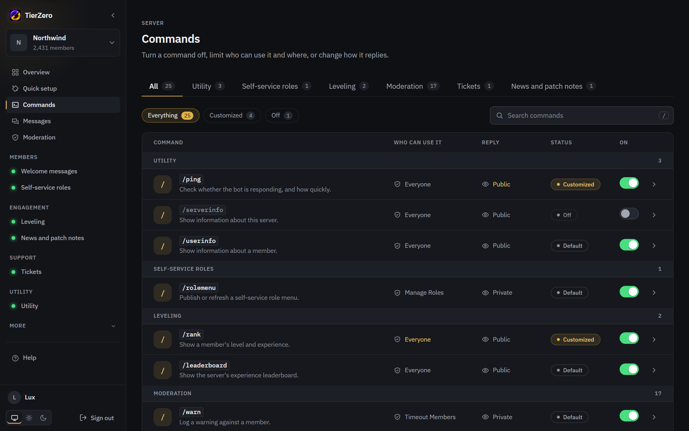

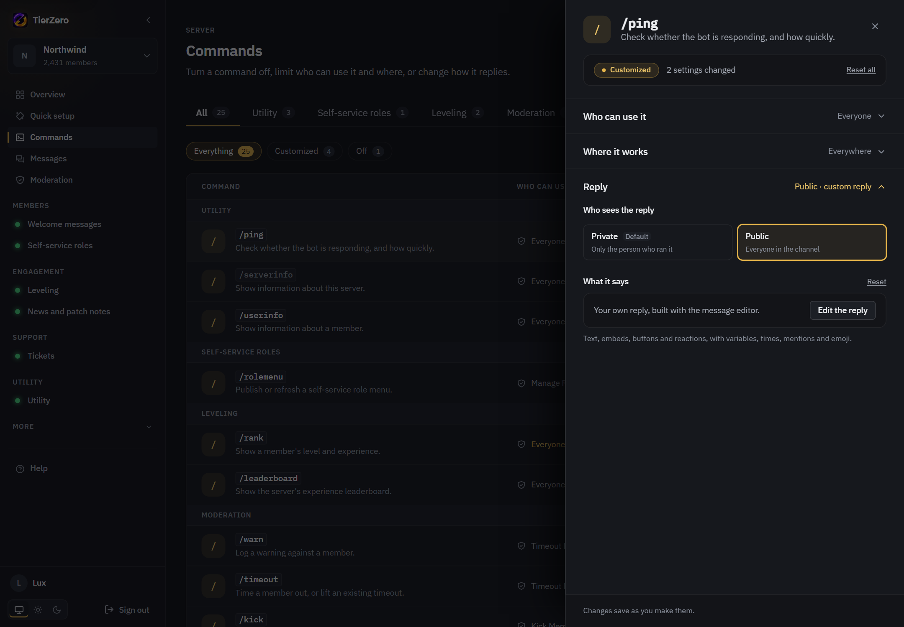

## Message creator

The Message creator page builds messages and embeds for the bot to post, such as rules, announcements or event notices. The preview beside the editor draws the message the way Discord shows it, with your server's real name and member count. In a narrow window it sits above the editor. A picture whose address comes from a variable is shown as a frame, since the real picture is only known when the bot sends. Each embed has a **Name** that only you see in the editor, which helps when a message has several. It is never sent.

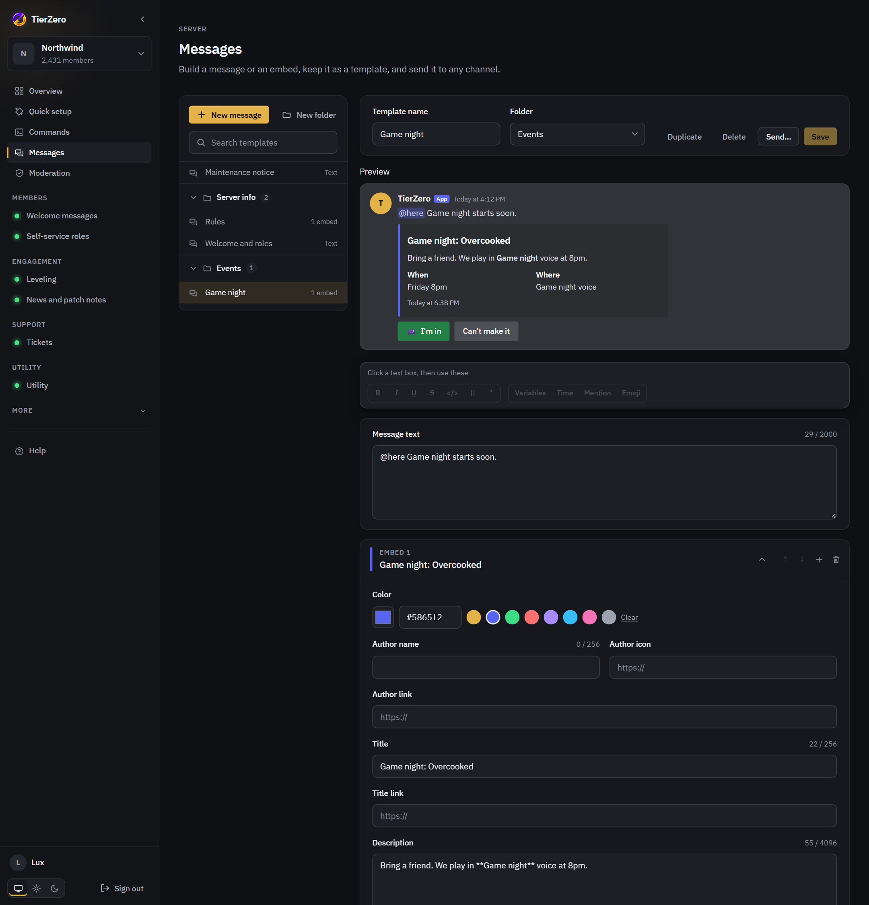

What you can set:

- Message text, with buttons for bold, italic, underline, strikethrough, code, spoilers and quotes.
- Up to 10 embeds. Each has a color, an author with icon and link, a title with a link, a description, up to 25 fields (inline or not), an image, a thumbnail, a footer with an icon, and a time in the footer. The time can be none, the moment it's sent, or a time you pick.
- Up to 25 buttons, five to a row. Each has a label, an optional emoji, a color (blue, grey, green or red) and an off switch that greys it out. A link button opens a web address. The others do something when pressed, which you choose.
- Up to 5 menus, each on a row of its own: a list of your own choices, or a picker for members, roles, members or roles, or channels. A menu sets how few and how many can be picked, a placeholder, whether it's off, and for a channel menu which kinds of channel appear. Each of your own choices has a label, a description, an emoji, and whether it starts picked.
- Up to 20 reactions the bot adds under the message.

A button, a choice, or a member, role or channel menu can do nothing, reply, or give or take a role. A reply is built with the same text and embeds as a message, with `{user}`, `{user.mention}` and `{selected}` filled in for the person who used it, and is private by default. A role action gives the role, takes it away, or toggles it, and can say something back. The bot can only change roles below its own highest role.

What a message's buttons and menus do is saved when the message is sent, so editing the template later doesn't change a message that's already out.

Above each text box there are tools to insert:

| Tool | What it adds |
| --- | --- |
| Variables | A name in braces that the bot fills in when it sends: `{server}`, `{members}`, `{channel}`, `{channel.name}`, `{date}`, `{time}`, `{now}`, `{sender}`, `{bot}` and `{server.icon}`. The preview fills them in with stand-ins. A name in braces the message doesn't know is sent exactly as typed, and the editor lists it under the message so a typo is caught. |
| Time | A Discord timestamp. You pick a date, time and style (short time, long date, relative and so on), and each reader sees it in their own timezone. |
| Mention | A role, a channel, @everyone, @here, or a member by user ID. |
| Emoji | Your server's custom emoji and a set of common ones. |

A mention is stored the way Discord stores it, such as `<#1200000000000000008>`, so the editor lists under the text box which channel, role or member each one is.

Name a message and press Save to keep it as a template. Folders group templates, one level deep. Deleting a folder moves its templates out and deletes nothing. The open template is in the address, so a reload or a shared link opens it again, and the list shows when each template was last sent. Leaving the page, or opening another template, with changes not saved asks first.

**Available in tickets** sits beside the folder. Tick it and staff can pick the message from the ticket reply box (see [Replies from the dashboard](#replies-from-the-dashboard)). It is saved with the template, shows as a **Tickets** chip on its row in the list, and the chip can be pressed to turn it on or off without opening the template. **Only those available in tickets** above the list narrows it to the flagged ones. Templates start with it off. A reply can only carry embeds, so the buttons, menus and reactions of a flagged template are left out when staff use it.

Send posts it to the channel you pick, after a confirmation that shows the message once more. The bot needs View Channel and Send Messages there, and Embed Links for an embed. Each send has its own options: send under another name and picture (through a webhook, which needs Manage Webhooks in that channel), send silently, pin it, publish it to followers of an announcement channel, hide link previews, read it out loud, start a thread on it, and reply to a message. These are chosen when you send and aren't saved with the template.

A sent message can mention people and roles. @everyone and @here only ping when you turn on "Let @everyone and @here ping" for that send, and Discord still ignores them unless the bot has the Mention Everyone permission.

Sending through the dashboard takes what sending by hand takes. You need to be able to see and write in the channel, Mention Everyone for an @everyone ping, and Manage Webhooks to send under another name. A button or menu that gives or takes a role needs Manage Roles and a role above that one, as in Discord. The server owner, anyone with Administrator and the install owner can do all of it. A scheduled message is checked again each time it goes out, so it stops if the person who scheduled it loses those rights.

**Schedule** in the same dialog sends it later instead: pick a channel, a date and time in your own time zone, and whether it goes once, every day or every week. What goes out is the message as it was when you scheduled it, so editing the template afterwards doesn't change it. Scheduled messages are listed under **Scheduled** below the templates, where one can be cancelled. A message that repeats keeps its time of day, and if the bot was off when one was due, it goes out once when the bot is back rather than once for every missed day. If a repeating send fails, the list shows why.

**Replace a sent message** puts the message in the editor in place of one TierZero already sent. Pick it from the messages sent from the Message creator, or paste its link (in Discord, open the message's menu and choose Copy Message Link). Only messages TierZero sent can be replaced, including ones sent under another name. Its buttons start doing what the new version says, and its reactions stay as they are.

Every message sent from the Message creator, now or on a schedule, is kept on a list. An open template shows where it was sent under **Sent**, newest first, each with a link to the message in Discord and a **Replace** button that puts the template as it is now in its place. Taking one off the list leaves the message in Discord. Nothing is removed from the list by itself.

### Messages the bot sends by itself

Where a feature has a message that is a setting, it shows a small preview of the message and an **Edit message** button instead of a text box. The button opens the editor from the Message creator: text, embeds, buttons, menus, reactions and variables, with a preview beside it. The editor starts from what the bot sends now, so you can change one word without rebuilding anything. Nothing is kept until you press **Use this message** and then Save on the settings page.

A variable is a name in braces that the bot fills in when it sends, like `{user}` or `{level}`. The Variables tool lists the ones that message understands first, then the ones every message has. **Go back to the default** puts the original wording back.

Almost everything the bot posts or sends works this way: the punishment DM and the mod log post, automod notices and log posts, welcome and farewell messages and their DMs, level-up announcements, the ticket panel and the messages around a ticket, role menus and their replies, news and patch note posts, and each kind of log channel entry. Slash command replies are edited from the Commands page. The replies the bot gives on its own account, such as a command that is switched off or a failure, are edited on the [Bot messages](#bot-messages) page.

Messages written before the editor existed are kept and show up as plain text in it. If an edit ends up too long once the variables are filled in, the bot sends the default instead of nothing. Buttons and text menus work in a direct message too. Menus of roles, channels or people do not, and reactions are dropped. A role button in a direct message changes the role on the server the message came from.

## Bot messages

The Bot messages page lists every message the bot sends, from every feature, in one place. Use it to find a message without knowing which feature it belongs to, or to see all the wording on a server at a glance. It's in the sidebar, below the Message creator.

The page opens on a card for each feature, with how many messages it has and how many you've changed. A short **Common messages** row above the cards goes straight to a fixed set of messages members see first, such as the welcome greeting, the automod notice and the first ticket panel. Click a card to see that feature's messages, grouped the way its settings page groups them. A feature with more than twelve messages opens with its groups closed. **Expand all** opens them. Use **All features** to go back. The feature is in the address, so the browser's back button and a reload keep your place.

Each message is one row: a dot for the kind of message, its name, the first line of what it says now, and an **Edit** button. The dot is red for a refusal or error, green for something that went through, amber for a warning and gold for a notice. Its name is also in the row for screen readers. The **i** button on a row says when the bot sends it, and the same line is at the top of the editor. Edit opens the same editor as the settings pages, and the message is saved the moment you confirm it, with no separate Save. A message you've changed has an **Edited** tag. **Reset** puts the original wording back.

- **Search** looks at a message's name, when it is sent, the feature it belongs to and the words it says now. Every word you type has to match, in any order. Press `/` to jump to it. While there's something in the box, the page lists the matches from every feature in one plain list. Clear it to go back to where you were.
- **Edited only** shows just what you've changed, on the cards, in a feature and in search.
- A feature that's switched off still lists its messages, dimmed, so you can write them before you turn it on.
- Command replies are listed too, under **Command replies** in the feature the command belongs to. They open the same editor as the Commands page.
- **Open settings** at the top of a feature goes to that feature's own page. Short pieces of text that aren't messages, such as a channel name, a button label or the reason in the audit log, aren't on this page. They are under **Labels and text** on the feature's page, or **Buttons and form text** for tickets.

The first group, **Bot replies**, belongs to the bot itself rather than to a feature. It has no switch and is always on. Under **Replies and errors** it holds what members are told when a command's feature is switched off, when a command is turned off in a channel or limited to roles they don't have (`{roles}` lists the allowed ones), and when a command fails. It also holds what a role button or menu says when the role no longer exists, sits above the bot's own, can't be changed, or was given or taken away, when a message's buttons are no longer active, and when a button, menu or form stops with an error. A button's own confirmation, if you wrote one, is used instead of the server's usual one. Each is shown only to the person it answers.

Under **Labels and text**, **Bot replies** also holds the name shown for a role or channel that no longer exists in a limited menu, the name of the webhook used when a message is sent under another name, who a message from the dashboard says it is from when you don't give a sender (`the dashboard` to start with), and the reason written to Discord's audit log when removing a case on the dashboard lifts a timeout (`Case #{case} removed by {actor}`).

Every message starts as the wording the bot has always used. If your wording no longer fits Discord's limits once its variables are filled in, the bot sends the original instead of nothing.

The default replies are embeds, coloured by what they say: red for refusals and errors, green for something that went through, amber for a heads-up, and gold for everything else. Edit any of them to change that. Where a message has to notify someone, such as a welcome or a level-up, the mention stays as plain text above the embed, because a mention inside an embed does not ping. An embed needs the Embed Links permission in the channel. Without it the bot posts the same message as plain text instead and notes that in its log. A member who has turned off link and embed previews in Discord's settings won't see embeds in direct messages, so edit the text of a direct message to plain if that matters to you.

## Moderation

Warnings, timeouts, kicks, bans and temporary bans. Each gets a numbered case you can look up later.

- **Role hierarchy is checked before anything is sent to Discord.** A moderator can't act on someone whose highest role is at or above theirs, the bot can't act above itself, and nobody can act on the server owner. You get a refusal that says why.
- **A temporary ban schedules its own unban.** It's stored in the database, so a restart doesn't leave someone banned. Unban by hand first and the pending one is dropped.
- **Discord's limits apply.** Timeouts cap at 28 days, and bulk delete can't touch messages older than 14 days.
- **Cases outlive the action.** Unbanning keeps the row, marked inactive.
- **Every action checks who is asking.** A slash command, the right-click menu and the dashboard all need the Discord permission for the action or a staff role that covers it, whatever the command's visibility is set to in Discord. Nobody can act on themselves, on the bot or on the server owner. `/case` and `/history` are for staff, like the right-click **Member history**.
- **Nothing is sent before Discord can do it.** The bot checks that it can time out, kick or ban the member, and refuses with a reason if not, so nobody is told they were banned by a ban that could not happen. If Discord still refuses after the member was messaged, they get a short correction.
- **Only members are messaged.** Someone who is not in the server, such as a user id banned ahead of time, is never sent a direct message, except that a confirmed ban being lifted still tells its member.
- **A temporary ban that cannot be lifted is tried again.** If Discord refuses the unban, the bot tries again after 1, 5, 15 and then every 60 minutes for a day, and only records the unban and messages the member once it has worked. A ban someone already lifted by hand is closed on the record without a message. Work waiting on a server the bot has not loaded yet, or on a feature that is switched off, waits instead of being dropped.
- **`/purge` is written to Staff activity.** Who deleted how many messages in which channel. It is not posted to the mod log, because that post is built around a case and a member.
- **The reason goes to the member as written.** The reason a moderator types is both the note on the case and the text in the member's direct message. Leave anything meant only for staff out of it. The default message does not name the moderator; `{moderator}` and `{moderatorId}` are there if you want them.

A mod log post can carry a **View in dashboard** button that opens that case on the member's record, scrolled to and highlighted. The address in the link is learned from the instance owner: whenever the owner has the dashboard open, its address is saved, and an address that only works on the same machine, such as `localhost`, is replaced as soon as the owner opens the dashboard on a real one. If the link is wrong, for example behind a proxy that hides the real address, type it into **Dashboard address** in the moderation settings, which takes priority over the saved one. Until one of the two exists the button is left off the post. The same button is on the posts automod makes and on the stock `/case` reply. The link only works for moderators who can sign in to the dashboard; anyone else gets the usual access refusal.

A case that staff removed in the [moderation dashboard](#moderation-dashboard) is hidden from `/history` and `/case`. The row stays in the database and shows in the dashboard, marked as removed.

### Wording you can change

Everything the module posts or sends on its own can be rewritten with the message editor (see [Messages the bot sends by itself](#messages-the-bot-sends-by-itself)). On the module's settings page:

- **Direct message to the member** is what a member is sent when action is taken on them, if **Direct message the member when action is taken** is on. One message covers every action, because `{action}` becomes warned, timed out, kicked, banned, unbanned or timeout cleared. Besides the variables every message has, it understands `{action}`, `{actionTitle}` (the same with a capital), `{reason}` (or "No reason given"), `{reasonNote}`, `{evidence}`, `{evidenceTitle}`, `{case}`, `{caseNote}`, `{channel}`, `{when}`, `{expires}`, `{expiresRelative}`, `{expiryNote}`, `{duration}`, `{warnings}`, `{warningNote}`, `{rule}`, `{appealNote}`, `{liftedNote}`, `{moderator}`, `{moderatorId}` and `{moderatorName}`. The ones that end in `Note` are sentences with their leading space or line break, and all of them are empty when they don't apply. The default message is an embed that says `You were {action} in {server}.` followed by whichever of these apply, and its fields and footer are left out when empty. Buttons work, including ones that open a web address, which suits an appeal link. Reactions and the role, channel and user menus are dropped, because a direct message can't carry them.
- **What the member is told.** Besides what happened and the reason, the default message shows the case number in the footer and the time it happened. A timeout or a temporary ban shows how long it lasts and when it ends. A second or later warning says "This is warning 3", counting only warnings that still count, and never says what the next one leads to. An escalation rule's action is told the same way, and `{rule}` holds the rule's name. A ban says how to appeal while **Let banned members appeal** is on, and the appeal button sits under the message. An unban or a cleared timeout says the restriction was lifted. The mod log and Staff activity keep the full detail.
- **The messages behind an action.** When a moderator attaches messages to an action in the dashboard, or uses the right-click **Warn**, **Timeout**, **Kick** or **Ban** on a message, or automod acts on a message, the member sees those messages in the direct message under **Message** or **Messages**. Each is shown as they wrote it, cut to about 300 characters, with the channel, the time and a link to it while it still exists. A message that was deleted before the action is shown from the copy kept with the case, marked deleted and without a link. Files are listed by name only, with no link. Up to five messages are shown, and a line says how many more there were. Pings are broken, so nothing in a quoted message notifies anyone. **Include the messages in the direct message** turns this off for the whole server and sends the reason alone.
- **The moderator's name** is not shown by default. **Show who took the action** adds their display name to the message. An action the bot takes by itself, such as an escalation, never shows one. `{moderator}` still works in a message you wrote yourself, whatever this says.
- **Messages you wrote earlier.** A direct message you changed keeps your wording, and it doesn't show the attached messages. Add `{evidence}` where you want them, or add an embed field named `{evidenceTitle}` with the value `{evidence}`. A message that still says what the old default said, including one the dashboard saved for you without any change, is read as the new default, so it shows the messages. The same goes for the automod direct message.
- **Mod log post** is the embed posted in the mod log channel. It understands the same variables plus `{case}`, `{member}`, `{memberId}`, `{created}`, `{caseUrl}` (a link to the case in the dashboard) and `{memberUrl}` (a link to the member's record). An embed field whose variable is empty is left out, which is how the default leaves the Expires line off warnings and kicks. A link button whose address comes out empty is left out the same way, which is how the default **View in dashboard** button (`{caseUrl}`) disappears until the bot knows the dashboard's address. The direct message to the member never has these two.

The replies to `/case`, `/history`, `/purge` and the right-click **Member history** are edited on the Commands page, as the replies to `/warn`, `/timeout` set, `/kick`, `/ban` and `/unban` already are. `/history` fills in `{user}`, `{count}` and `{list}`, where `{list}` is one line per case. `/purge` fills in `{count}`, `{messages}` and `{skippedNote}`. `/case` uses the mod log variables plus `{reversedNote}`, which says when the action has since been reversed.

Two collapsed sections lower on the settings page hold everything else the module says in Discord. Each starts with the wording the bot has always used, now shown as an embed, and you can edit any of them to change that.

- **Replies and errors** has one short message for each thing a moderator can be told, grouped by when they see it. *Actions that are refused* covers a missing reason, a reason or length that is too long, a length that can't be read, acting on yourself, the bot or the server owner, not being allowed to take the action, a member who outranks the moderator or the bot, a member who isn't in the server, a member who is already banned or isn't banned, an action Discord would refuse, and an action Discord refused after the member was messaged. *Staff checks and the right-click menu* covers someone who isn't on the staff list, an action only admins may take, a message with no member behind it, picking yourself or the bot in the menu, and a form that is out of date. *Cases and history* covers a case number that doesn't exist and a member with no history. *Purge* covers the four ways `/purge` can fail to run. *Confirmations* has the reply to `/timeout clear` and the confirmation shown after a right-click warn, timeout, kick or ban, which can use `{name}`, `{case}`, `{notes}` and, for a timeout, `{until}` or, for a ban, `{expiry}`. *Direct messages* has the correction a member is sent when an action they were told about didn't happen. Each message says when it is shown, and lists the values it can use, such as `{name}`, `{max}` or `{verb}`.
- **Labels and text** holds the short pieces the messages are built from: what each action is called (Warned, Timed out and so on, and "No reason given"), the phrases that complete "You are not allowed to ... here" and "I could not ...", the sentences added after an action ("They are not in the server, so the ban stops them from joining again"), how lengths of time are written, how a line of `/history` is laid out, how `/purge` counts messages, the titles, boxes and hints of the right-click forms (each limited to what Discord allows, shown as you type), and the reason the bot gives when it lifts a temporary ban. These names also appear in direct messages and the mod log, because they fill in `{action}`, `{reason}` and the like. The dashboard keeps its own names and its own error messages.

Two kinds of text can't be edited from here. The names and descriptions of the commands and of their options are registered with Discord and can't be changed after the fact. The lines the bot writes to [Staff activity](#staff-activity) are shown in the dashboard, not in Discord. If an edited message ends up too long once the variables are filled in, the bot sends the default one instead.

### Reason presets

Reasons you give often can be kept ready under **Reason presets** in the Moderation settings. A preset has a name (up to 60 characters), a reason (up to 500) and, if you want, a length. You can keep 25.

- **In the dashboard**, the action form for a warn, timeout, kick or ban has a **Preset** box. Picking one fills in the reason and, for a timeout or a ban, the length. You can still edit both before you send. A timeout is never longer than 28 days, so a longer preset length is cut to that and the form says so.
- **In the right-click forms**, the first 25 presets are in a dropdown above the reason box. Pick one, or write your own reason in the box. A reason you write wins.
- **In `/warn`, `/timeout`, `/kick` and `/ban`**, the `reason` box suggests your presets as you type. Picking a suggestion, or typing a preset's name yourself, uses that preset's reason. If you gave no length, a timeout or a ban starts at the preset's length.

The reason on the case, in the member's message and in the mod log is the preset's reason, not its name.

### Deleting the message with the action

When an action is based on a message, the moderator can have the bot delete that message together with the action. It works for a warning, a timeout, a kick and a ban.

- **In the dashboard**, the action form has **Also delete this message** (or **these 3 messages**) as soon as a message is attached. That includes the form opened from the right-click menu on a message in a ticket or in the logs. It starts off or on according to **Delete the message by default when acting on it** in the Moderation settings, which is off until you turn it on. The moderator can change it each time.
- **In Discord**, the right-click **Warn author**, **Timeout author**, **Kick author** and **Ban author** forms have a **Delete the message too** choice with Yes and No, starting at the same setting. A form that was opened before you updated has no choice and follows the setting.
- **Only the attached messages are deleted**, in the channels they were sent in, never more than 20 at a time. The bot needs the Manage Messages permission in those channels. The message is deleted after the action has gone through, so an action Discord refuses deletes nothing.
- **If a message can't be deleted**, the action still goes through and the result says which ones were left, and why when it is the missing permission. A message that is already gone counts as done.
- **The case keeps what was said.** The copy saved with the case stays readable. It is marked **Message deleted** on the case, on the member's record and in the mod logs, and the case says how many were deleted. The deletion is also written to Staff activity, and the server log lists the message as deleted by that moderator. If the member is sent a direct message, it shows the message as removed, without a link.
- **Anyone who may take the action may choose this.** It needs no extra role.

### Warnings that expire

**Warnings stop counting after**, in the Escalation part of the Moderation settings, makes warnings run out. Leave it empty and they count for good. With a length set, a warning older than that is marked expired. It stays on the record and in the CSV, but it no longer counts toward the member's warning total or toward automatic escalation. This covers warnings from moderators and from automod. The Members list, the member's page, Member actions and escalation all use the same rule, so they agree. The Members list shows how many of a member's warnings have expired next to the ones that count.

### Automatic escalation

Escalation rules let the bot act by itself when a member collects warnings. Under **Automatic escalation** in the Moderation settings, add up to ten rules. Each has:

- **Warnings**, from 2 to 50, and **Within the last (days)**. A window of 0 counts every warning on the record.
- **Then**: time out (with a length), kick, or ban (with a length, or empty for permanent).
- An optional **Name**, which is shown on the case. Without one the case says what the rule counts, such as "3 warnings in 30 days, then time out".

After every warning, whether a moderator or automod gave it, the bot counts the member's warnings against the rules. A rule fires when the count reaches its number. It fires once for each run of warnings. After it fires it waits for new warnings, so the same three warnings don't set it off again. When more than one rule is reached, the one that needs the most warnings acts, and on a tie the one listed first.

The action is a case of its own, with the bot as the moderator. It says it was automatic and shows which rule fired and how many warnings it counted. It is posted to the mod log, the member gets the usual direct message if that is on, and [Staff activity](#staff-activity) gets a line for it. When a moderator's warning in the dashboard sets off a rule, the form says so. An automatic case is not itself a warning, so one rule can't set off another.

The bot leaves some members alone: the server owner, the bot, anyone on the Access list, administrators, anyone with a role listed under **Roles never escalated**, and anyone the bot's role can't act on. It also skips an action that would change nothing, such as banning someone already banned or timing out someone who has a longer timeout running. The reason is written to the bot's log. In automod, each rule that warns has **Count its warnings toward automatic escalation**, on by default.

Removing an automatic case from the record doesn't make the rule fire again for the same warnings.

### Raid tools

The **Raid tools** tab is for admins and the owner. It needs Moderation switched on, and locking channels needs the bot to have the Manage Roles permission.

**Join-rate alert.** In the **Raid** part of the Moderation settings, turn on **Join-rate alert** and choose how many members joining within how long counts as a raid. When it goes off, the bot posts in the mod log channel and, if you ticked **Lock the server down as well**, locks every channel a lockdown covers, for as long as you set or until someone unlocks. It goes off once for a burst, then stays quiet for at least five minutes. The count is kept in memory, so a restart in the middle of a burst loses the joins counted so far.

**Lockdown.** Pick channels on the tab, or press **Lock all**, and give a length or leave it open. A locked channel stops @everyone from sending messages, sending in threads, starting threads, adding reactions and speaking. Members can still read and see it. Channels members can't see are skipped, and so are the ones listed under **Channels a lockdown leaves alone** in the settings. Before it changes a channel the bot saves what the @everyone overwrite said about each of those permissions. Unlocking puts back exactly that: a permission that was allowed is allowed again, a denied one is denied again, and one that was left to roles is left to roles. Any other change made to the channel in the meantime is kept. If the lock created the overwrite and nothing else uses it, the overwrite is removed again. The saved state is in the database, so a restart in between loses nothing, and a lockdown with a length ends on time after one. The end is a Moderation task, so it waits while Moderation is switched off and runs once it is back on. Locks and unlocks on a server run one at a time, and a channel that is already locked keeps the state saved when it was first locked. The bot can post a notice in each channel it locks and unlocks, and you can edit both notices.

`/lockdown channel`, `/lockdown server` and `/lockdown end` do the same from Discord. Discord shows them to members with Manage Channels, so admin staff without that permission need the command allowed for them on the Commands page. The bot itself accepts both. Each lock and unlock is a line in Staff activity.

**Mass ban or kick.** Paste user IDs (up to 200), or choose a window of up to seven days in which people joined. The **Last 10 minutes** and **Last hour** buttons fill in the start and leave the end empty, which means up to the moment you preview or confirm, so someone who joined seconds ago is included. **Preview** lists exactly who would be acted on, and who would be skipped and why: yourself, the bot, the server owner, staff, someone whose top role is at or above yours, or someone the bot can't act on. Nothing runs until you hold the confirm button under the preview, and changing anything after the preview throws it away. The bot works out who would be acted on again when you confirm and refuses if it is no longer the same list, even when the number of members is the same. Only one mass action runs per server at a time, and a second request made while one is starting or running is refused. The page shows the progress and lists each member that failed. Every member actioned gets a case, and one line goes to Staff activity. Members are not sent a message.

### Ban appeals

Turn on **Let banned members appeal** in the **Appeals** part of the Moderation settings. The direct message a member gets when they are banned then carries an **Appeal this ban** button. Bans made before you turned it on have no button.

The button opens a form in the member's direct messages. It asks one question, which you can reword, and takes 10 to 2,000 characters. An appeal is filed against the ban the member is under. These rules apply:

- Only a member Discord has banned can appeal.
- One appeal per ban can wait at a time.
- After a denial the member waits **Wait after a denied appeal** (7 days unless you change it, and 0 lets them try again at once) before appealing the same ban again.
- A member can press the button or send the form five times in ten minutes.

New appeals are posted in the channel you choose, or the mod log channel if you don't, with a link to the Appeals tab.

The **Appeals** tab is for admins and the owner. It shows pending appeals by default, with filters for the decided ones. Opening one shows the member's text next to the ban, their whole record, their notes and their other appeals. **Accept** lifts the ban the same way a normal unban does, so it becomes a case and appears in the mod log. **Deny** keeps the ban. Both take an optional message that is sent to the member. Every decision is a line in Staff activity. Deciding needs Moderation switched on. If the member can't be sent a message, because they no longer share a server with the bot or don't accept messages from it, the dashboard says so after the decision is saved.

Everything the member is told is a message you can edit in the same part of the settings: the post about a new appeal, the accepted and denied messages, and the replies to the button, such as the one for a cooldown. The accepted and denied messages can use `{reason}` (what the ban was for), `{evidence}` and `{evidenceTitle}` (the messages kept with the ban) and `{when}`. The default denied message shows the ban's reason and those messages, so the member can see what the decision was about.

## Moderation dashboard

The Moderation area in the sidebar is where staff read a member's record, leave notes, take back a mistaken action and see how moderation is going. It shows the cases the moderation and automod features record, so there's nothing extra to switch on.

| Tab | What it's for | Who sees it |
| --- | --- | --- |
| Overview | Statistics | Staff |
| Members | Everyone with something on file | Staff |
| Mod logs | Member actions (every case) and Staff activity (what staff changed) | Staff. Staff activity is for admins and the owner |
| Server logs | What happened on the server | Admins and the owner, and moderators if **Let moderators open the server logs** is on |
| Appeals | Ban appeals to read and decide | Admins and the owner |
| Raid tools | Lockdown, and mass ban or kick | Admins and the owner |
| Access | Who can use all of this | The owner |
| Settings | Moderation, Automod and Server logs settings | Anyone with Manage Server |
| Danger zone | Deleting whole logs | The owner |

A search box in the header finds a member from any tab. Press Ctrl+K (Cmd+K on a Mac). On a phone the tabs scroll sideways, and the edge fades where more tabs are hidden. Someone with Manage Server who isn't staff is taken straight to the Settings tab.

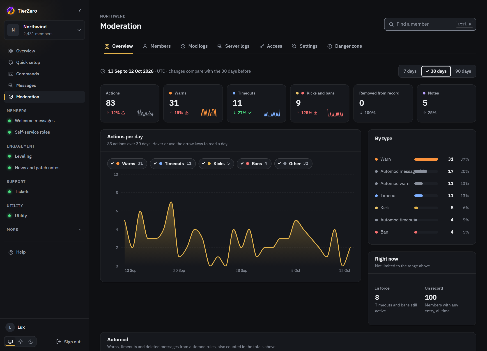

### Who can use it

- **The owner of the install** is the Discord account that owns the bot's application, or the user ID in `INSTANCE_OWNER_ID` if that is set. For an application owned by a team, it is the team's owner. The owner can use Moderation on every server the bot is in.
- **Everyone else** can use it only on servers where the owner has added them, as a Moderator or an Admin. The owner does that on the Access tab, by name or Discord user ID, even before the person has opened the dashboard.
- **Manage Server** doesn't make someone staff. It opens the Settings tab and nothing else under Moderation. Being staff doesn't give access to a server's settings either.

| Permission | Moderator | Admin | Owner |
| --- | --- | --- | --- |
| Read member records and statistics | Yes | Yes | Yes |
| Write notes | Yes | Yes | Yes |
| Warn, time out, end a timeout | Yes | Yes | Yes |
| Edit a case | Their own | Any | Any |
| Take a warn or timeout off a record | Yes | Yes | Yes |
| Kick, ban, unban | No | Yes | Yes |
| Read staff activity, export member actions as CSV | No | Yes | Yes |
| Open the server logs | If switched on in the Server logs settings | Yes | Yes |
| Delete the server logs (in the Danger zone) | No | No | Yes |
| Edit or delete others' notes, restore deleted notes | No | Yes | Yes |
| Put a removed action back | No | Yes | Yes |
| Take a kick, ban or unban off a record | No | No | Yes |
| Purge an action or note permanently | No | No | Yes |
| Choose who has access | No | No | Yes |

Anyone can edit or delete their own notes.

### Member records

The Members tab lists everyone with an action or note on file, automod's actions included (the shield in the Actions column). You can filter to members who are restricted right now, have notes, or were acted on in the last seven days, and sort by the most recent action, the most actions, the most notes or name. A sort applies as soon as you pick it. A member's page shows their roles, join date and account age, and a timeline of actions, notes and (for admins and the owner) staff activity, each labeled with what it is. Staff changes to a case or note are kept in that entry's history, under its details, rather than listed again beside it. A long timeline shows the newest 30 entries first, with **Show older** for the rest. Times on a member's page are in your own time zone and say which one, while the logs use UTC.

Notes are for staff only. Members never see them and the bot never sends them to Discord. A note is up to 2,000 characters and a member can carry 200.

Nothing disappears from the timeline when it's removed. A removed action or deleted note stays in place, marked with who removed it and when. Admins and the owner can still read a deleted note. A moderator sees that it was deleted and by whom, but not the text.

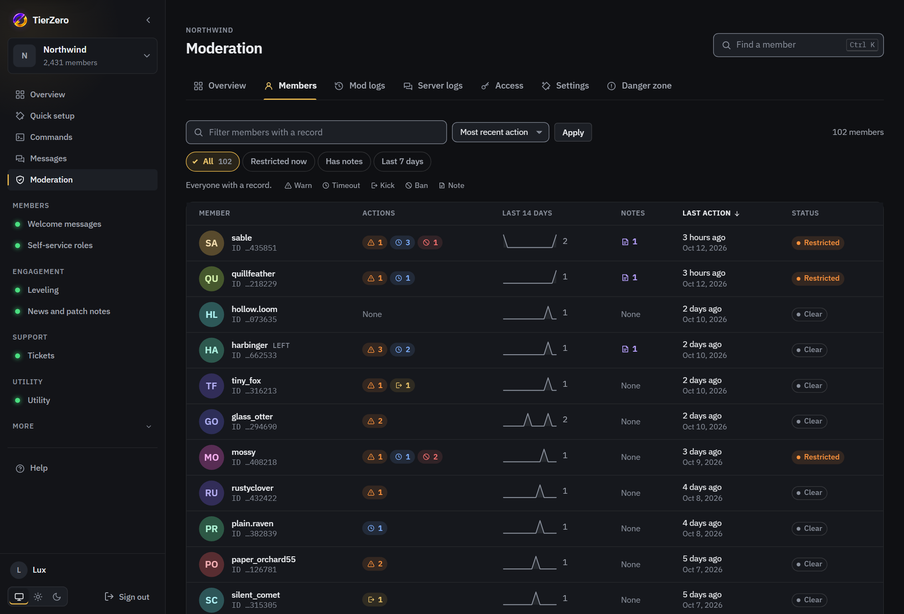

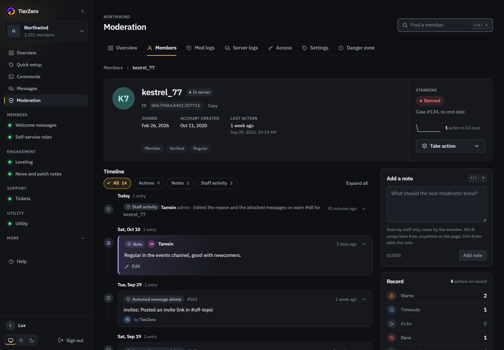

### Taking action

The **Take action** button on a member's page offers what your level allows, and only what fits the member. Whether someone is banned or timed out is checked with Discord, so Unban shows for anyone Discord has banned, even with no ban case on the record. Clear timeout shows only while a timeout is running. An action the bot would refuse stays in the menu, greyed out with the reason: the member is the server owner, the bot, yourself, has a top role level with or above yours or the bot's, or has left the server. **Change timeout** on someone already timed out shows when the current timeout ends, starts with no length picked, and warns you when the new end is sooner than the current one. Each choice opens a short form with a reason (up to 500 characters, and required if the Moderation setting says so) and, for timeouts and bans, a length. A ban can also delete up to 7 days of the member's messages.

Warns, timeouts, kicks and bans also have an **Attach messages** section. It lists the member's latest messages in any channel you can read, deleted ones included, and you tick the ones that belong on the case (up to 10). You can also paste a message link for one that isn't listed. Attached messages show on the case in the member's timeline and under Member actions. The list comes from the Messages part of [Server logs](#server-logs) when that is on. Without it, the bot only remembers the last three days in memory, and that is empty after a restart, so a link is the way to attach anything older. A message that was edited has a dropdown with every version, and the case keeps all of them. Once you tick it, choose which version broke the rules, the original or any edit. The case shows that version first, marked as the one the member was warned for, with the rest under the dropdown. This works the same for a message that was edited and then deleted. A deleted one carries a red Deleted label. File names are kept, but the files stay on Discord and their links can stop working. CSV exports include the links only.

It runs the same code as the slash commands, so it behaves the same: hierarchy check, direct message if that setting is on, the Discord action, the case, the unban schedule for a temporary ban and the mod log post. The case names you as the moderator.

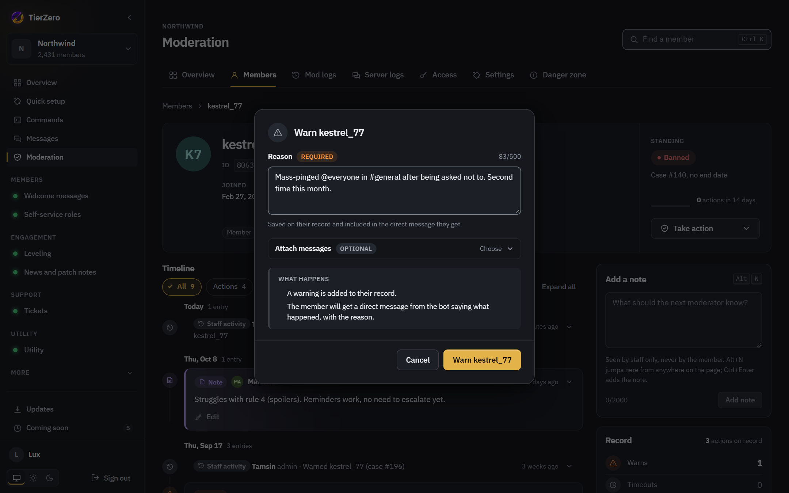

Refused with a message that says why:

- The Moderation feature is off, or the action's command is switched off on the Commands page.
- The target is the server owner, outranks you, or (for anything that changes Discord) outranks the bot. A warning only writes a record, so the bot's position doesn't stop one.
- The target is you or the bot.
- You aren't a member of the server, since your roles can't be compared. The install owner is the exception.
- Another action on that member is still running, or you've taken 20 actions in a minute.
- A ban longer than 3,650 days. Leave the length empty for a permanent ban.

A member who has left can still be warned, banned and unbanned. A warning on them is a record only. The dashboard never sends a direct message to someone who isn't in the server, except on an unban.

### The right-click menu in Discord

With Moderation on, staff can act without opening the dashboard. Right-click (or long-press) a member or a message, choose **Apps**, and pick an entry.

- On a member: Warn member, Timeout member, Kick member, Ban member, Member history.
- On a message: Warn author, Timeout author, Kick author, Ban author.

Actions open the same form as the dashboard. From a message, the message itself is attached to the case: its text, channel, time and any file names, copied as they read when you acted. The copy stays readable if the member edits or deletes the original. If the bot never saw the message, only a link is added to the reason.

Discord shows an entry only to members with the matching permission: Timeout Members for warn, timeout and history, Kick Members for kick, Ban Members for ban. Seeing it isn't enough. The person also has to be on the staff list or be the install owner, with the same levels as the dashboard. If a moderator can't see the entries, give their role Timeout Members. Server owners can change who sees each entry under Server Settings, Integrations. Each entry is also a command on the Commands page, so it can be switched off or limited like any other.

### The right-click menu in the dashboard

Right-click a person or a message anywhere in the dashboard to act on them without leaving the page. That covers names and avatars in a ticket's conversation and transcript, the opener and People list on a ticket, member rows, the member chips in Member actions, Staff activity, the server logs, appeals and raid tools, and the ticket lists. The context menu key or Shift+F10 opens it from the keyboard, and so does the **...** button, which stays visible on touch screens. Hold Shift while right-clicking, or right-click selected text, to get the browser's own menu instead.

- **On a person:** View moderation profile, Warn, Timeout (Change timeout while one is running), Clear timeout, Kick, Ban or Unban, Copy user ID, Open in Discord.
- **On a message in a ticket:** Warn author, Timeout author, Kick author, Ban author, Copy message text, Copy message link, then the author's profile and Copy user ID. The message is attached to the case. If the bot can't copy it, for example because the ticket channel is gone, the form offers to put the message link in the reason instead.

Choosing an action opens the same form as **Take action**, over the page you were on. When it goes through, a notice says what happened and links to the case.

The menu lists what your level allows and nothing else, using the same rules as **Take action**, so an action the bot would refuse is greyed out with the reason underneath. Entries show greyed out for a moment while the bot checks. Someone without a moderation level, such as a ticket handler, gets only Copy user ID and Open in Discord. Apps and webhooks, like the bot's own replies, can't be acted on.

### Editing a case

Open a case on the member's page and choose **Edit case**. You can change the reason, the attached messages (remove one, add one, or choose which version of an edited message the member was warned for), and, while a timeout or ban is still running, how long it lasts. A new length counts from now and is applied in Discord straight away, including making a ban permanent. A timeout or ban that has already ended can't have its length changed.

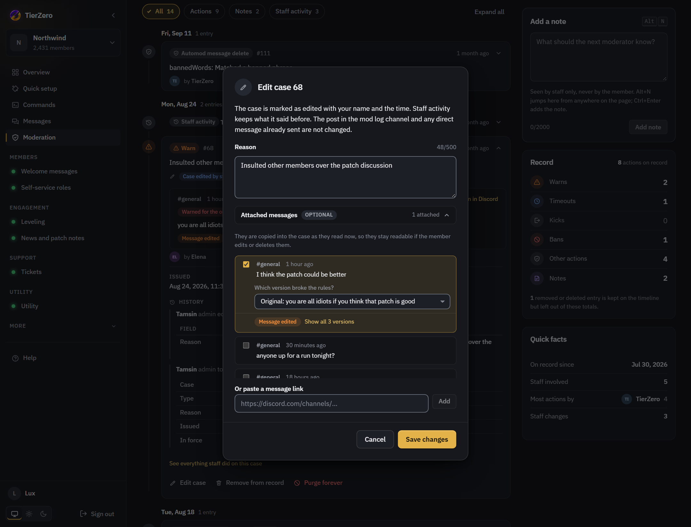

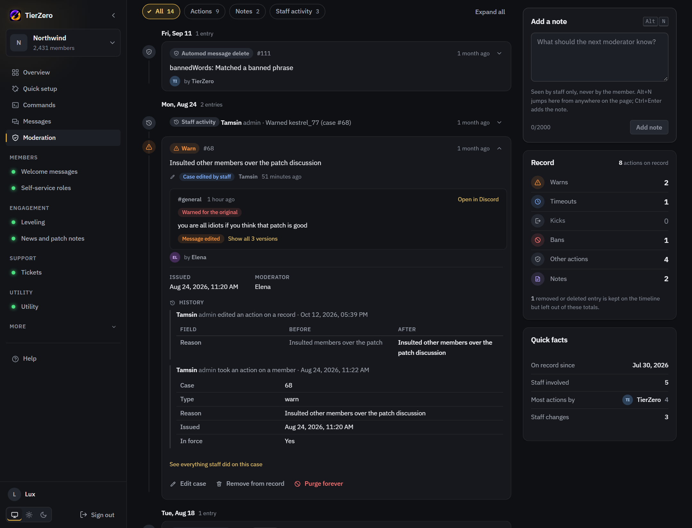

Moderators can edit their own cases, admins and the owner any case, including automod's. Changing the length of a ban needs the same level as banning. A case that was removed from the record has to be restored first.

An edited case shows a blue **Case edited by staff** note with who and when, on the member's page and in Member actions. That is different from the amber **Message edited** label inside an attached message, which means the member changed their own message. Staff activity records every edit with what it said before and after, and each case has a **See everything staff did on this case** link, which Member actions also offers as **Staff activity** next to **Profile** on every row. The post in the mod log channel and any direct message already sent keep the old text.

### Removing, restoring and purging

Three levels, each stronger than the last.

**Remove from record** keeps the entry on the timeline, struck through, with your name, the time and a required reason. It stops counting in totals, statistics, `/history` and `/case`. Moderators and admins can remove warns and timeouts (automod's included). Only the owner can remove a kick, ban or unban. Removing a timeout that's still running also lifts it in Discord, unless the member has left, the bot ranks below them, or another timeout on them is still in force. Removing a ban that's still in force also lifts the ban in Discord, so the record and Discord agree. The dialog says so, and the button reads **Remove and lift the ban**. The Discord ban stays if another ban case on the member is still in force, and Staff activity records what happened in Discord. The message after you confirm says which of these happened: the ban was lifted, it stayed because another ban case is in force, it could not be lifted (the bot may lack Ban Members), or the member was not banned any more.

**Restore** puts a removed action or deleted note back. Admins and the owner can. It never changes anything in Discord, so a restored timeout isn't reapplied and a restored ban isn't repeated. A restored ban only counts as in force if Discord still has the member banned.

**Purge forever** is for an entry that shouldn't exist at all. Only the owner can, after typing `purge`. It deletes the entry and every audit entry about it, and leaves no trace. It can't be undone. SQLite may keep the deleted bytes inside `tier0.db` until they're overwritten, and older backups still contain it, so it isn't secure erasure. The `/purge` command that bulk deletes messages is unrelated.

Case numbers are never renumbered or reused. Purging case 12 leaves a permanent gap, and no later case gets 12.

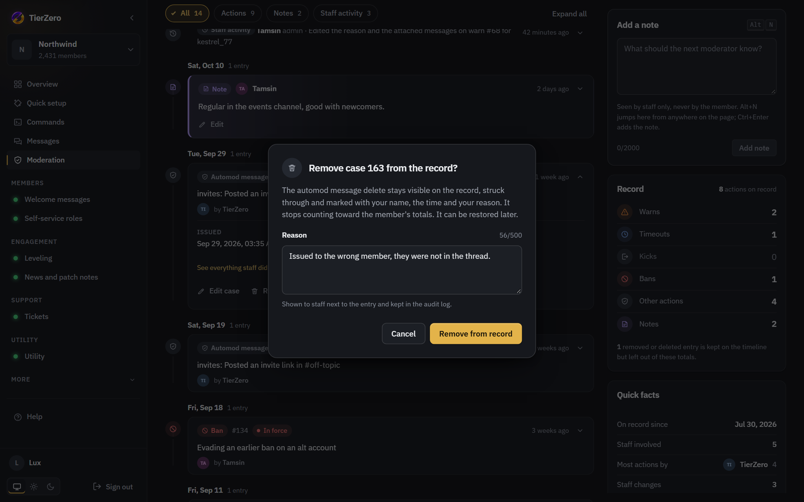

### Server logs

The Server logs tab is a searchable record of what happened in the server, so staff don't have to scroll channels or Discord's own audit log to find it. It's off until you turn on the **Server logs** feature. Choose what to record in its settings, which you reach from the **Settings** button on the tab:

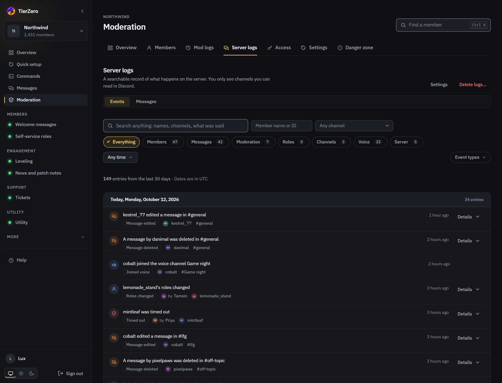

- **Members:** joins, departures, nickname changes and role changes.
- **Messages:** every message members post, every edit and what was deleted, including messages removed by /purge. Bots are left out.
- **Moderation:** bans, unbans, kicks and timeouts, from any source, with who did it when Discord says.
- **Roles:** roles created, changed (name, colour, permissions) and deleted.
- **Channels:** channels and threads created, changed (name, topic, category, slowmode, permissions) and deleted.
- **Voice:** joining, leaving and moving between voice channels, and being server muted or deafened.
- **Server:** server settings, invites and emojis.

Who did something comes from Discord's audit log, so the bot needs the View Audit Log permission, which the invite link already asks for. Without it the log still works and entries just don't say who. Things the bot did for one of its features, such as making a ticket channel, show under the bot's own name. Only what an automod rule did shows as Automod.

The tab has two views. **Events** is the timeline of everything above. Every filter applies as soon as you change it and shows as a chip you can take off:

- Search any text: names, channels, summaries, and what was said in edited and deleted messages.
- Category chips, with how many entries each has under your other filters. You can pick several.
- **Event types**, to pick exact events such as "Roles changed" and "Joined voice".
- A member, by name or ID. It matches who did something and who it happened to. Clicking a name in an entry filters to that person.
- A channel, and a date range with shortcuts for today, 7 days and 30 days.

An entry's **Details** show what changed, before and after.

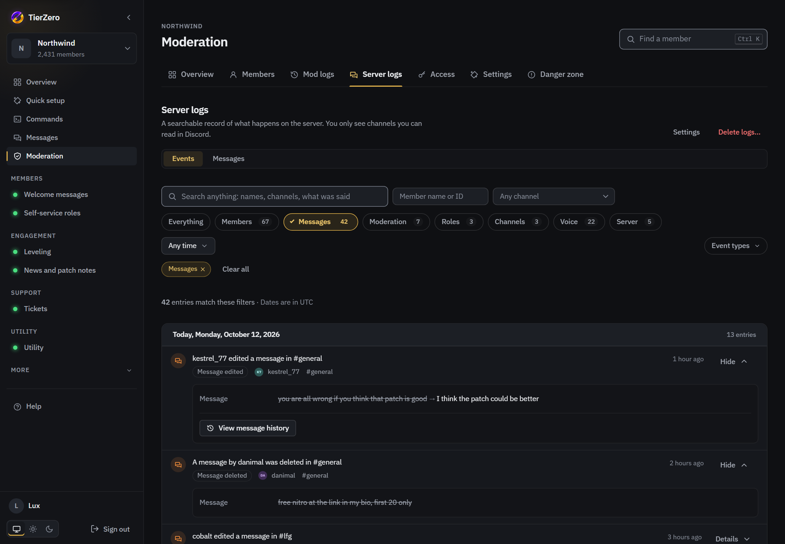

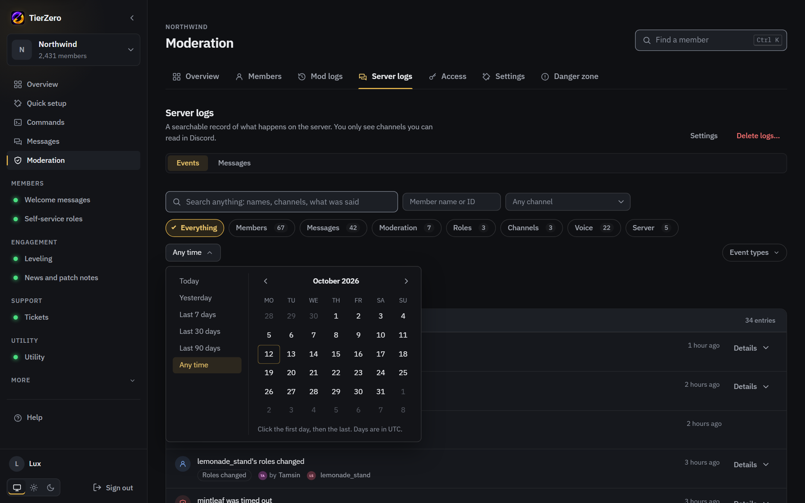

A message entry links to the message with all its versions. The filtered view is in the address, so you can bookmark it or send it to another moderator.

**Messages** is the saved text itself.

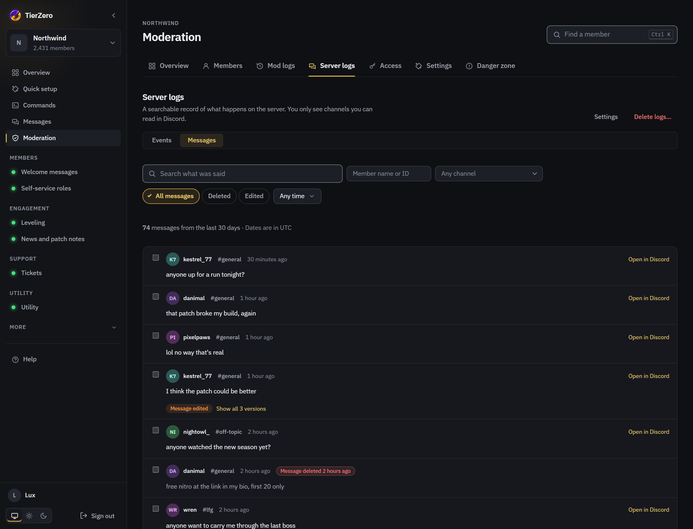

Search by words, member, channel and dates, and show only deleted or edited messages. A search also matches earlier versions, so an edited message is found by what it said before. Deleted messages are labelled in red, with who deleted them when the bot could tell: the author, a moderator, Automod or the bot. Moderator deletions need the **View Audit Log** permission. Discord records nothing when members delete their own messages, so with no matching audit entry the message is shown as deleted by its author. Messages deleted before this was recorded, or ones the bot never saw, are just labelled Deleted. Edited messages have a dropdown with each version. A message with no text says what it did carry, such as a file or a sticker. Tick messages from one member and choose **Take action** to open the action form with them already attached.

Staff only see channels they can read in Discord, so the logs can't be used to get into a private channel. Admins and the owner can always open the tab. Moderators can if you switch on **Let moderators open the server logs**.

The logs are stored in this installation's database, not on Discord, and Messages holds everything members type, so tell your members. You choose how many days to keep (30 by default) and old entries are deleted automatically. You can leave channels out, such as private staff ones. Switching a kind off, or the feature off, stops saving but doesn't delete what's there. The owner can delete the logs from the [Danger zone](#danger-zone), which the **Delete logs** button on the tab opens. Admins can't. Files members attach aren't copied: Messages keeps their names and links, which stop working when Discord removes the file.

A server that already had the message log on keeps it, now as the Messages part of Server logs with the same days and settings. The other kinds start off for those servers.

### Staff activity

The Mod logs tab has two pages with a switch at the top: Member actions and Staff activity. Staff activity is for admins and the owner and lists what staff did, in the dashboard and in Discord: actions taken on a member (warn, timeout, kick, ban, unban and clearing a timeout), notes added, edited, deleted or restored, actions removed or restored, and staff added, changed or removed. The owner's changes are included. Actions taken from Discord, with a slash command or the right-click menu, are listed the same way, with the case, the reason and how many attached messages were deleted. Someone who acts in Discord without being on the staff list is shown as a Discord moderator. Actions taken from Discord before this version aren't listed, and a case's **Staff activity** link says so when it finds nothing. Automod's cases are listed too, always under the name Automod. The line says what it did, the case number and what matched, such as the invite code or the banned words. This page is staff only, so the match is safe here. It never goes in the channel notice or the DM. The message it acted on stays on the case. Choose Automod in the staff member filter to see only those. Purges are listed as well. Entries show who did it and at what level, and edits and removals expand to show before and after. You can filter by type, staff member, member ID, date range and words. The same entries appear on a member's timeline as staff activity.

Click an entry to open it on the member's record. Entries about a case open that case, and entries about a note open that note, scrolled to and highlighted. A removed case still opens, struck through. Entries that aren't about a member, such as staff changes and purges, aren't links. The **Changes** button on an entry is separate and still shows the before and after.

Cases made by commands and automod are the actions themselves, under Member actions.

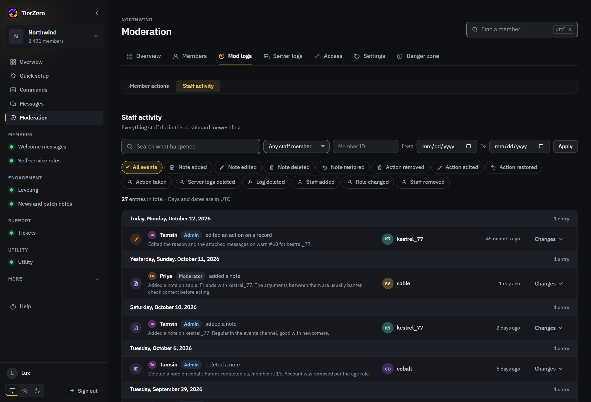

### Statistics

The Overview tab covers the last 7, 30 or 90 days, All time, or a Custom range you pick with a start and end date (up to two years). Days are in UTC. All time starts from the first action or note on record. The tiles count actions (excluding removed ones), warns, timeouts, kicks and bans, removed cases and notes written. Each compares with the previous period of the same length, and a fall in actions, warns, timeouts or kicks and bans shows as an improvement. The comparison only appears when there's older data to compare with, so All time never shows one.

The chart shows one point per day for ranges up to three months. Longer ranges show one point per week, and ranges over two years show one per month.

**Download CSV** saves the figures for the range you're looking at as a spreadsheet file: one row per day (or week or month, matching the chart), a row of totals, and a row for each moderator.

Below the tiles:

- **Right now:** timeouts and bans in force, and members with anything on record. Not limited to the range.
- **Repeat actions:** the share of members actioned again within 30 days of an earlier action. It appears once at least five members were actioned. Automod, unbans and cleared timeouts don't count.
- **Automod:** what automod's rules did in the range, which rules fired most, and a link to Member actions filtered to automod.
- **Busiest hours:** actions by hour of the day, in UTC.
- **Moderators:** who acted, how much, and when they last did. Selecting a name opens Member actions for them. Automod is one of the rows, always called Automod and shown with a shield instead of the bot's Discord name and picture. It looks the same in the action log, on a member's timeline and in the CSV export.
- **Recent activity:** the latest actions. Automod's say which rule acted, by its name, such as Banned words or Rate limit.
- **Most actioned members:** the ten with the most actions.

### Member actions

Member actions, on the Mod logs tab, lists every case, newest first. You can filter by type, state (in force, expired, removed or on record), source (manual or automod) and moderator, and search the reason, a case number (with or without the `#`) or a member ID. It doesn't search by name. An automod case shows its rule by name in a tag before the reason. Asking for a page past the end of a list says so and links to the last page, here and on the other lists.

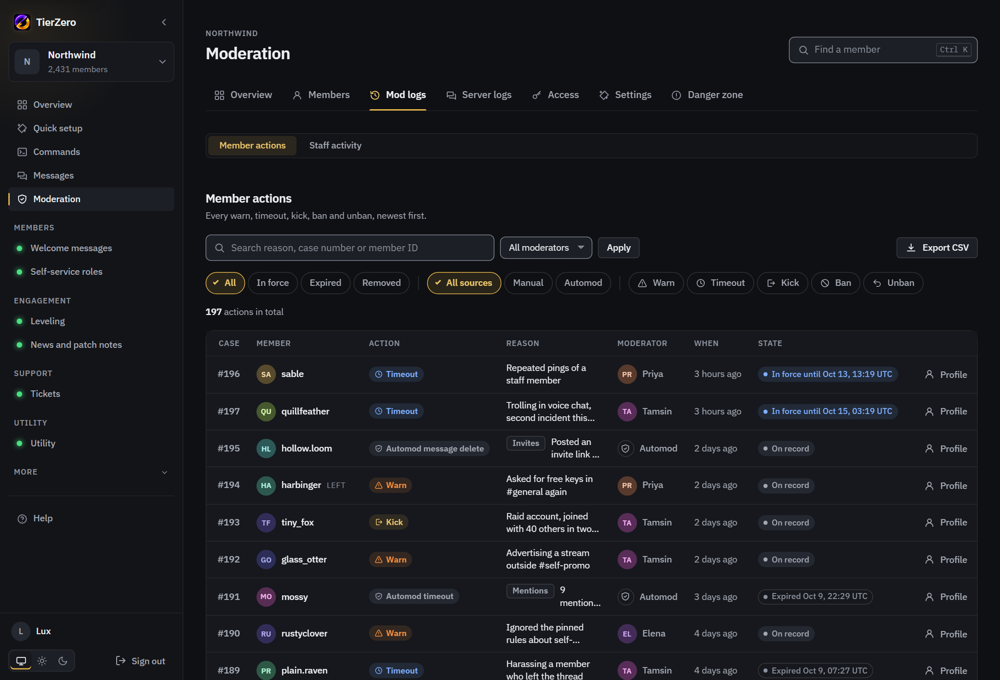

Admins and the owner can export the current filter as a CSV, newest first, up to 5,000 rows. Removed entries are included. The state column uses the same words as the page (in force, expired, on record, removed), and an automod case's reason starts with its rule's name. Names are looked up from Discord, so the oldest cases in a large export can have blank names, and the ID columns are always filled in. Cells that start with `=`, `+`, `-` or `@` get an apostrophe in front so a spreadsheet won't treat them as formulas. Strip it if you load the file anywhere else.

### Access tab

The owner adds staff to a server, switches them between Moderator and Admin, and removes them. Bots can't be added. Removing someone takes away their access and nothing else. Their notes and actions stay. Every change is in Staff activity.

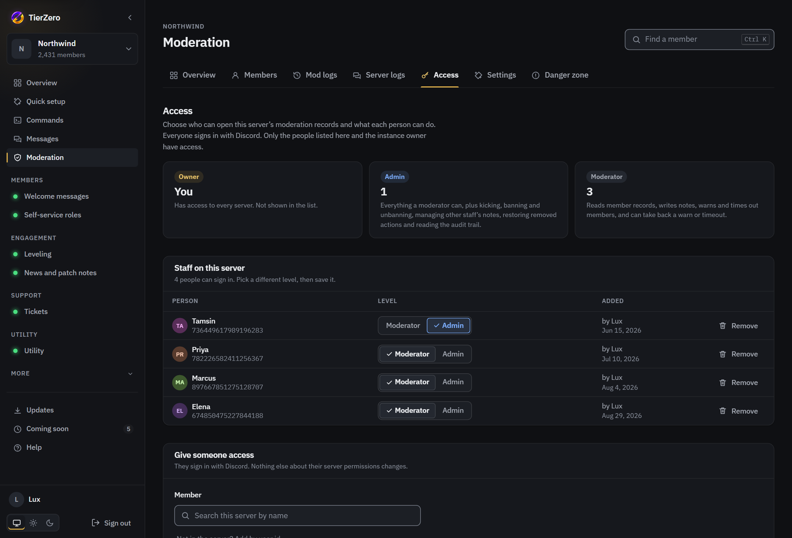

### Danger zone

The owner has a **Danger zone** tab that no one else sees. It deletes whole logs for good: Member actions (every case on every record), Staff activity, the Server log events and the saved messages. Each shows how many items it holds. Tick any number of them, then hold the button for three seconds while a red bar fills it, so a stray click does nothing. Letting go early cancels. One entry is left in Staff activity saying who deleted what. It can't be undone, so back up `tier0.db` in the data folder first if you might want the logs back. Staff notes, staff access and settings aren't touched. Deleting Member actions while keeping Staff activity leaves the entries about those cases, which then open the member's record instead of a case that's gone. The Server logs tab's **Delete logs** button leads here.

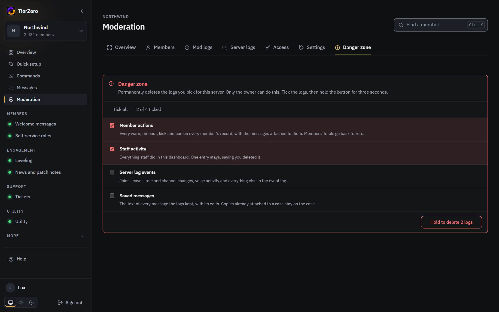

### Settings tab

Moderation, Automod and Server logs settings live here, with a switch at the top to move between them. They're the usual settings forms, and the old pages for them redirect here. Leaving a form with changes that aren't saved, by the switch, another tab or the browser's Back button, asks first. Opening the tab needs Manage Server, which a staff role doesn't include.

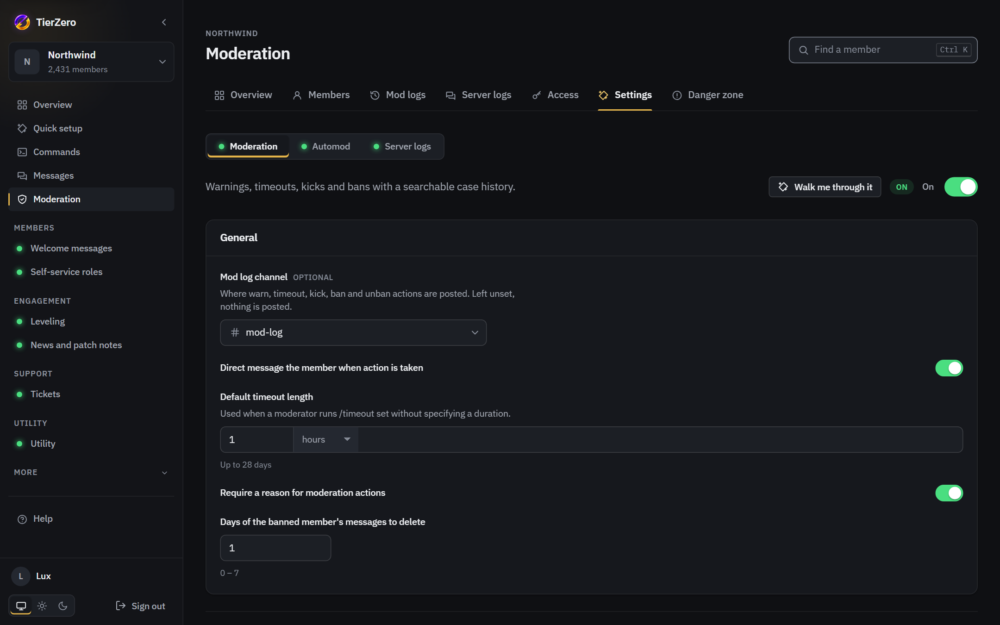

### Sidebar

The sidebar shrinks to a strip of icons with the button in its header or Ctrl+B (Cmd+B). The browser remembers it per browser, not per account. On a phone it's a drawer.

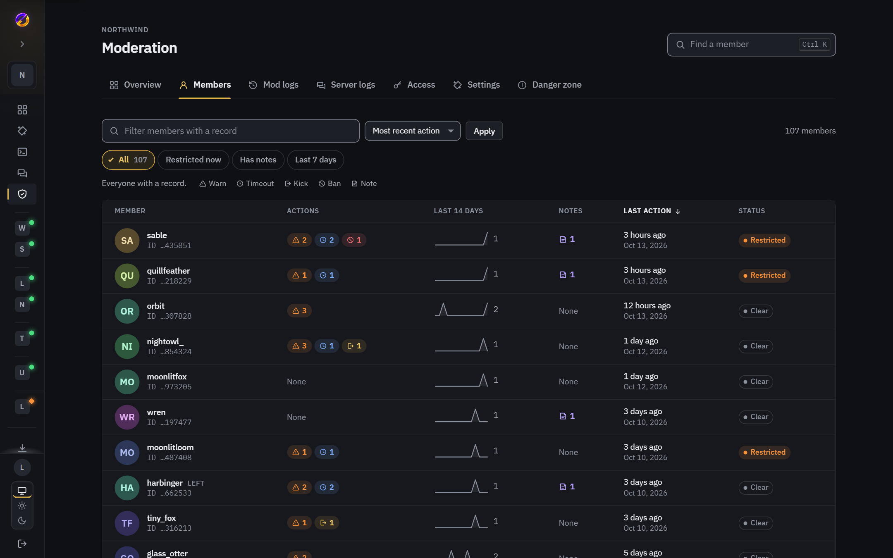

## Automod

Seven rules you switch on separately, each with its own actions and exemptions: invites, links, capital letters, repeated text, mention limits, banned words and rate limiting. Every rule starts off, so switching the module on does nothing until you pick some.

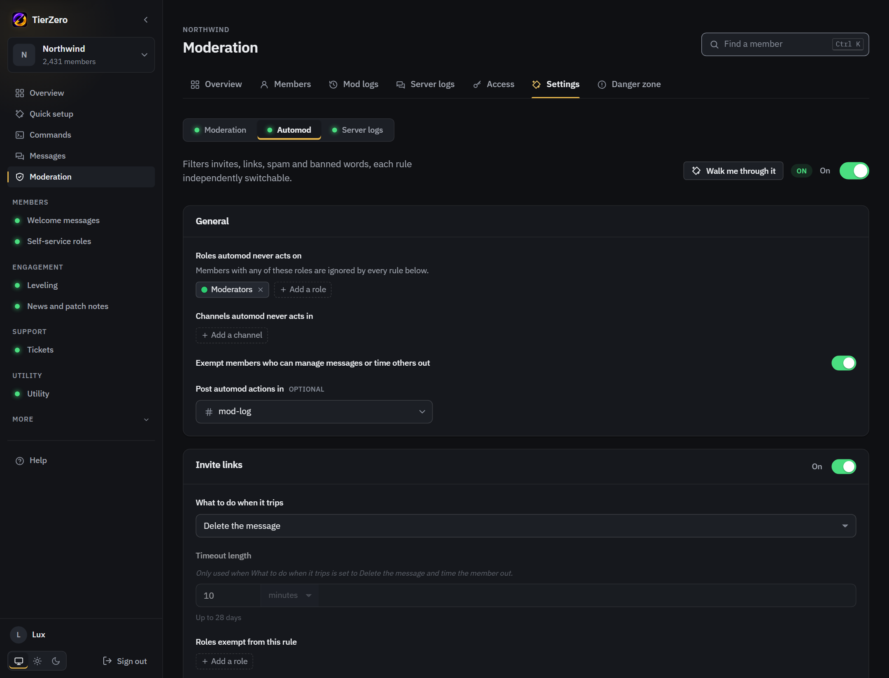

Banned word matching is conservative on purpose. Text is lowercased, common letter-for-number swaps are folded back, a letter stretched out three or more times is collapsed, and it matches on word boundaries. So `assassin` doesn't trip a rule for the rude three letters inside it. The cost is that spacing letters out gets past it, since catching that means stripping whitespace, which glues unrelated words together and brings the false positives back. Missing a few real cases beats deleting innocent messages.

Anyone with moderator permissions is exempt by default, and you can turn that off. When several rules trip on one message, only one rule acts: the one whose actions are most severe, meaning it times the member out, then warns, then only deletes, and the first rule listed wins a tie. Its actions are used as they are and never added to another rule's. A message in a thread follows the channel the thread is in, so exempting a channel exempts its threads too.

Each rule is a section that starts closed, with what it does written on its header and its On switch beside it, so you can look down the page without opening anything. **Expand all** opens every rule at once. Inside, the **What to do when it trips** list takes any combination of three things. **Delete** removes the message. **Warn** adds a warning to their record and leaves the message where it is. **Time out** mutes the member for the rule's timeout length, which only shows while that is ticked. It leaves the message where it is too. Pick delete as well if the message should go. A rule needs at least one. Each option in the list says what it does, and the suggested ones are marked. They are also what a rule does until you change it:

| Rule | Suggested |
| --- | --- |
| Invites | Delete, warn |
| Links | Delete |
| Excessive capitals | Delete |
| Repeated text | Delete, warn |
| Mass mentions | Delete, time out |
| Banned words | Delete, warn |
| Rate limit | Delete, time out |

Rules saved before this was a list keep doing exactly what they did. A rule set to delete still only deletes, one set to warn only warns without deleting, and the old "delete the message and time the member out" became delete plus time out.

What each rule reads:

- **Invites** looks for `discord.gg/code` and `discord.com/invite/code`. Allowed invites can be a bare code or a pasted link, with or without a query string.
- **Links** looks at the address of every `http` or `https` link. Allowed domains can be pasted as a whole link, such as `https://youtube.com/watch?v=1`, and only the domain is used. A domain also covers its subdomains. A link whose address isn't a valid domain (stray symbols, or a name followed by `@`) counts as not allowed.
- **Banned words** matches whole words in any alphabet, so a Cyrillic or accented word works, and punctuation next to a word doesn't hide it (`damn!`). The record and the log post list which entries of your list matched, not the member's whole message. A `*` in a word stands for a short run of characters with no space in it, so `free*nitro` catches `freenitro` and `free-nitro` but not `free games and nitro`. A star covers up to 32 characters, a word can hold two stars, and a word with more is matched exactly as written. The **Patterns** list takes regular expressions for owners who know them, matched without regard to case against the first 2,000 characters of a message. A pattern is checked when you save, and one that could run for a very long time is refused with the reason under the setting: repeating a group that repeats or is optional (`(a+)+`, `(a?b?)+`), references back to an earlier group, lookahead and lookbehind, a repeat above 100, and too many repeats in one pattern. In a pattern, `*` and `+` cover at most 32 characters. If a pattern still takes more than 50 milliseconds on a message, automod stops using it on that server for an hour and writes a warning to the bot's log. A match from a pattern is reported as the pattern, as a word is reported as the word.

Automod reads edits as well as new messages, since an edit is an easy way past a filter. An edit is only checked when its text changed, and it doesn't count as another message toward rate limiting or repeated text. A message is acted on once, even if Discord sends several updates for it.

Automod only reports what it managed to do. If the bot can't delete a message, or can't time a member out because they're an administrator, the owner, or above the bot, the notice and the record say only what actually happened, and the log post gets a **Not carried out** line saying what failed. A timeout that didn't go through is recorded as the warning or deletion that did, not as a timeout. Each trip is one case, filed under the strongest thing that happened (time out, then warn, then delete), however many actions the rule has.

Messages never repeat what the member wrote. The reason in the notice, the log and the record is fixed wording such as "Posted a Discord invite link". The specific invite code, domain or banned word that matched goes only to staff, in the **Matched** field of the log post and in the record on the dashboard.

Each trip also keeps the message itself on the case, as a moderator's attached message is kept: its text, channel, attachments and a note of whether it was deleted. If the member edited it into breaking the rule, the earlier versions are kept as well, from Server logs when that is on, and the version that tripped the rule is marked. It is kept even when the bot couldn't delete the message. This is staff-only and shows on the member's record in the dashboard, never in Discord. The log post carries the **View in dashboard** button, which opens the case. Automod's cases have case numbers like any other, and each one has a line in [Staff activity](#staff-activity) saying what automod did and what matched. Cases from before this was added get their line the next time the bot starts. The notice can only mention the member it is about, and the log post mentions no one.

### Wording you can change

Three things automod says are edited with the message editor, and a section of small pieces sits below them.

- **Notice in the channel** is posted where the message was removed and deleted again after the time in **How long the notice stays**: 8 seconds unless you change it, up to 5 minutes, anything under 2 seconds is taken as 2, and `0s` leaves the notice up. Besides the variables every message has, it understands `{user}` (a mention), `{userId}`, `{rule}`, `{ruleKey}` (the rule's internal key, `rateLimit` for example, whatever `{rule}` is set to show, so best kept out of what members see), `{action}` (what was done: delete, warn, timeout, or several such as delete and warn), `{reason}`, `{reasonNote}`, `{outcome}`, `{outcomeTitle}` and `{duration}`. `{reasonNote}` is a colon, a space and the reason, or nothing. `{outcome}` is chosen from what actually happened, for example your message was removed, you were timed out, your message was removed and you were warned, or your message was removed and you were timed out. When all that happened was a warning, it says that message tripped automod. The default is an embed that says `{outcomeTitle} ({rule}{reasonNote}).`, with `{user}` as plain text above it so the member is still notified. `{outcomeTitle}` is `{outcome}` with a capital letter.
- **Log posts** are the embeds sent to the log channel, one for each thing a rule can do (delete, warn, time out) so that each keeps its own colour. A rule that does several things uses the post for the strongest one that happened. They understand the same variables except `{outcome}` and `{reasonNote}`, plus `{match}` (the invite code, domain or banned words that matched, in code blocks so nothing becomes a link), `{problems}` (what the bot couldn't do), `{case}`, `{caseUrl}` and `{memberUrl}`. The default post shows these as **Matched** and **Not carried out** fields, which are left out when empty. `{match}` and `{problems}` aren't available in the channel notice. `{reason}` is a dash when there is nothing to add.

- **Direct message to the member** is off until you turn on **Also message the member privately**. It goes to the member whose message tripped a rule, so they know why without the channel seeing. It carries the same fixed reason as the notice, never what matched, and shows the member their own message under **Message** so they can see what it was about. The message is cut short, has no link when automod removed it, and can't ping anyone. **Show the member their message in it** turns that part off. The default is an embed that says `In {server}, {outcome} ({rule}{reasonNote}).`, with the case number in the footer and, for a timeout, a **Length** field. It understands `{user}`, `{userId}`, `{rule}`, `{ruleKey}`, `{action}`, `{reason}`, `{reasonNote}`, `{outcome}`, `{duration}`, `{evidence}`, `{evidenceTitle}`, `{case}`, `{caseNote}`, `{channel}` and `{when}`. A message you saved before `{evidence}` existed keeps working and doesn't show the member's message until you add it. It mentions nobody, and a member with direct messages closed is skipped.
- **Labels and text** is a collapsed section at the bottom. It holds how each rule is named in `{rule}` (by default in words, such as "banned words" and "rate limit", lower case because the notice uses it mid-sentence), the reason given for each rule, the eight phrases `{outcome}` is chosen from, the words `{action}` joins (delete, warn, timeout, and the comma and "and" between them), the dash used when there is no reason, the four lines that say what the bot couldn't do, the reason written to Discord's audit log when a member is timed out (`Automod: {rule}`), and how lengths of time are written. Earlier versions used the rules' internal keys as their names, such as "bannedWords", and members saw those. A name you saved back then that is still the key is read as the new default, and anything you typed yourself is kept. The dashboard always shows each rule by its name, such as Banned words, on the Overview, the member's record, Member actions and the CSV export.

Both are shown on the module's settings page, and the log posts only when a log channel is set. A message that comes out too long once filled in is replaced by the default. The automod lines in [Staff activity](#staff-activity) are shown in the dashboard and aren't editable here.

## Welcome messages

Greetings on join, farewells on leave, an optional direct message to each, and roles given on arrival. The greeting and the farewell are posted in the channel you pick, and nothing is posted while that is empty. Each of the four messages is edited with the message builder, so it can be an embed, carry an image or use any of the other variables. They start as a short line in an embed, and the join greeting mentions the member above it so they get notified. Edit any of them to change that. Besides the variables every message has, they understand `{user}` (a mention), `{username}`, `{server}` and `{memberCount}`. The two direct messages are off until you switch them on, and are only sent if the member allows DMs. A message you wrote before the builder existed is kept, and one that was set to send as an embed becomes an embed with the same text. These four are all the module says, so there is no other wording to change.

Roles can be given as soon as someone joins, after a wait you choose (from a minute to a week, and only if they are still on the server), or once they accept the rules in Discord's membership screening. A server without screening gets them on join either way. The bot can't give a role above its own, so the role picker greys those out. If one is moved above it later, the bot logs that and carries on with the rest of the join.

Bots are left out by default: a bot that joins or leaves gets no greeting, farewell, direct message or roles. Switch **Leave bots out** off to treat them like everyone else. A server that saved welcome settings before this switch existed keeps its old behaviour, so bots are still greeted and given roles there until you switch it on.

The feature shows **Needs setup** until it has something to do: a greeting channel, a farewell channel, a direct message or a role.

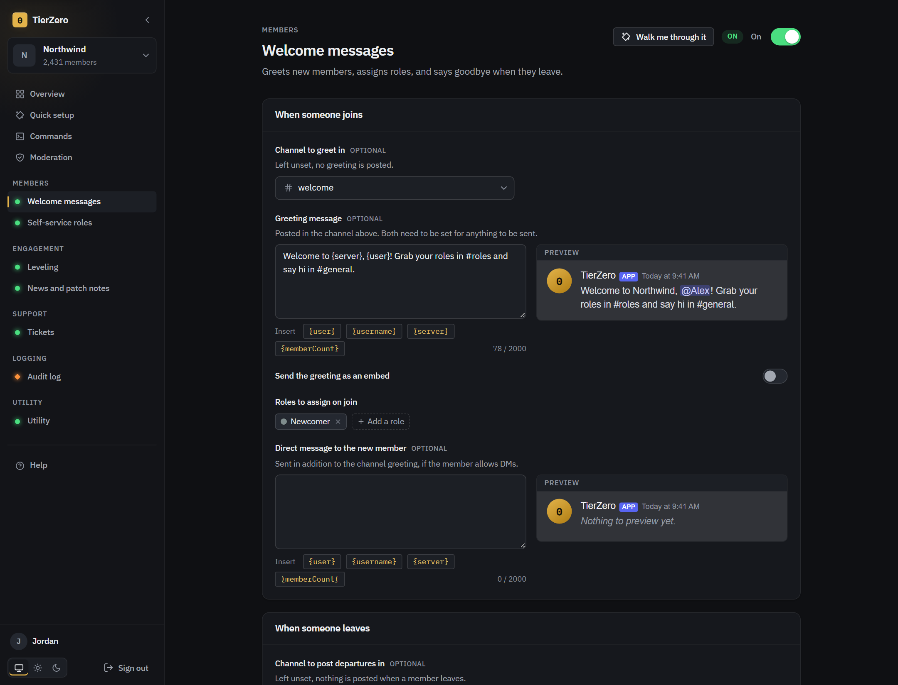

## Verification

New members get a role only after they pass a check. Pick a **Verified role** and, if you like, an **Unverified role** that is given on join and taken away on a pass. Hide your channels from everyone but the verified role and a new member sees nothing until they verify. The feature shows **Needs setup** until a verified role is picked.

**How members verify** is one of three:

- **Press a button.** One click.
- **Captcha.** A few quick rounds with no images, shown only to that member. **Rounds** says how many (one to five) and **Kinds of round** says which ones they are drawn from:
  - **Press the picture**: six emoji buttons, and they press the one they are told.
  - **Count them**: they count some pictures and press the number.
  - **Odd one out**: one button is different from the rest.
  - **Which does not belong**: three buttons are alike and one is not.
  - **Smallest to biggest**: they press three pictures in order of size.
  - **A small puzzle**: a sum, or a word to type backwards.
  - **Code in squares**: a four character code drawn in coloured squares, which they type. Each member's code has its own colours and a little noise. Leave it out if members use screen readers.

  Getting a round wrong ends the attempt and costs a try, and they start again from the first round with new ones. The buttons carry random ids, so nothing in them says which is right. The puzzles are in English and are not editable, but the text around each round is.
- **Answer a question.** You write the question and a list of accepted answers. Any one of them passes, ignoring capitals, accents and extra spaces.

For the captcha and the question, **Tries allowed** counts wrong answers. When they run out the member is either locked out for a length you set or removed from the server, and can join again and start over. A captcha or question that has gone unanswered for ten minutes, or that was shown before the bot restarted, is replaced when the member presses the button again, and the tries they have already used are kept.

**Where members verify** takes a channel, a direct message or both. With a direct message the bot sends each new member the message and its button as they join, and nothing is posted in a channel. A member with direct messages closed cannot verify that way, so pick both if that matters. For the channel, pick it under **Verification message**, save, then press **Post the verification message** on the settings page. `/verification post` in Discord does the same and needs Manage Server. The message is edited with the message builder, and the bot adds the button under it. Running the command again edits the message in place, and removes any extra copy in that channel, instead of posting a second one. The bot finds its own message by the button on it, so nothing is stored. If you change the channel, the old message stays where it was, so delete it yourself. The button keeps working after a restart. `/verification send user` makes a member verify again: it takes the verified role back, gives the unverified role, restarts the removal timer and sends them the verification message by direct message. It needs Manage Server.

Under **New members**:

- **Minimum account age** keeps very new accounts out. A younger account is either **held back**, which lets them join but refuses the button until the account is old enough (and tells them when), or **removed** as soon as they join.
- **A member who never verifies** is left alone by default. Choose to remove them after a wait from a minute to 28 days. This only applies to members who joined while the feature was on, and the wait survives a restart. A member who leaves, or is given the verified role by hand, is taken off the schedule.
- The bot can send a removed member a direct message with the reason first.

Bots are left out by default. A **Log channel**, if set, gets a post when someone verifies, runs out of tries or is removed.

**Raid protection** uses Discord's own defences when many people join at once. Set how many people and how short a time, such as 10 people within a minute. When that happens the bot raises the server's verification level to Very High, which only lets in accounts with a verified phone number, and pauses invites. After **How long it lasts** it puts both back, but only the level if it is still the one the bot set. It can tell a channel when it starts and ends. **Start raid protection now** and **End raid protection now** on the settings page do the same by hand. Both changes need the bot to have Manage Server. If the bot restarts during a raid, the protections still end on time, but **End raid protection now** can't find the raid until then.

The bot needs Manage Roles and Kick Members, and its role has to sit above the verified and unverified roles. The role pickers grey out any role above it. Every reply, the post in the log channel, the direct message and the wording of the buttons and boxes can be changed: the replies under **Replies and errors**, the button, box and removal-reason text under **Labels and text**. Replies understand `{user}`, `{username}` and `{server}`, plus `{role}`, `{round}` and `{rounds}`, `{symbol}`, `{row}`, `{grid}`, `{question}`, `{left}` (tries left), `{until}` and `{canVerify}` (times that count down) where they make sense. Log posts and the direct message add `{method}` and `{reason}`.

## Role menus

Choosing which roles a menu gives, here or in any other feature that hands out roles, is the same as giving the role in Discord. It takes Manage Roles and a role above the one handed out. Someone with Manage Server alone can still edit everything else, and can save a page whose roles were set by someone else. The server owner, anyone with Administrator and the install owner are never held back.

Members pick roles from a menu you post to a channel, either as buttons (one per role, five to a row, each in the colour you choose) or as a dropdown, which is tidier for a long list and can show a second line under each role. Both keep working after the message leaves the bot's cache, need no message content permission, and give the member a private confirmation. Picking a role you have takes it off again.

Each menu's row on the dashboard has a **Post in Discord** button and a line saying whether it is posted, where, and whether you have changed it since. Changes reach the posted menu when you press the button again, which edits the message in place rather than posting a second one, even after a rename. A menu moved to another channel is posted there and its old message deleted. Removing a menu from the list deletes its message when you save. `/rolemenu` does the same as the button from Discord, and suggests your menus as you type.

Mark a menu exclusive and picking one role clears the others, which suits a rank or a main platform. Otherwise you can cap how many of its roles a member holds at once. A menu can also be limited to members who have a particular role, such as a verified role.

**What picking a role does** decides whether a pick works both ways. A menu that only gives suits a rules or verify button: picking a role the member already has changes nothing and tells them so. A menu that only takes away suits dropping a notification role: nothing is given, and someone without the role is told there was nothing to remove. Every menu starts out giving and taking back, as menus always have.

The message above a menu is edited with the message builder, with `{menu}` for the menu's name, and the preview shows the buttons or dropdown under it. They come from the menu's roles and are added under whatever you write, so the builder doesn't offer buttons for it. A menu saved with a title and description keeps them as an embed. Under **Replies and errors** you can reword the private confirmations: one when a button gives a role and one when it takes one away, two for a button on a menu that only gives or only takes (the member already has the role, or doesn't have it), all with `{role}` and `{menu}`, one after a pick from a dropdown with `{roles}` (the menu's roles the member has now) and `{menu}`, and the one `/rolemenu` shows after publishing a menu, with `{menu}` and `{menuChannel}`. The refusals are there too, and also private: a menu name `/rolemenu` can't find (`{name}`), a menu whose channel was deleted, a menu the bot couldn't post or update, a button on a menu that was removed, a button whose role was taken off the menu, a role above the bot's own, a role Discord refused to change (both with `{role}` and `{menu}`), a member without the role the menu needs (`{required}` and `{menu}`), and a member already holding as many of its roles as it allows (`{max}` and `{menu}`). These replies start out as embeds. **Labels and text** holds the word used for `{roles}` when the member has none of the menu's roles left.

The feature shows **Needs setup** until it has a menu, and its quick setup asks for one. A menu added there still has to be posted with **Post in Discord** on its row.

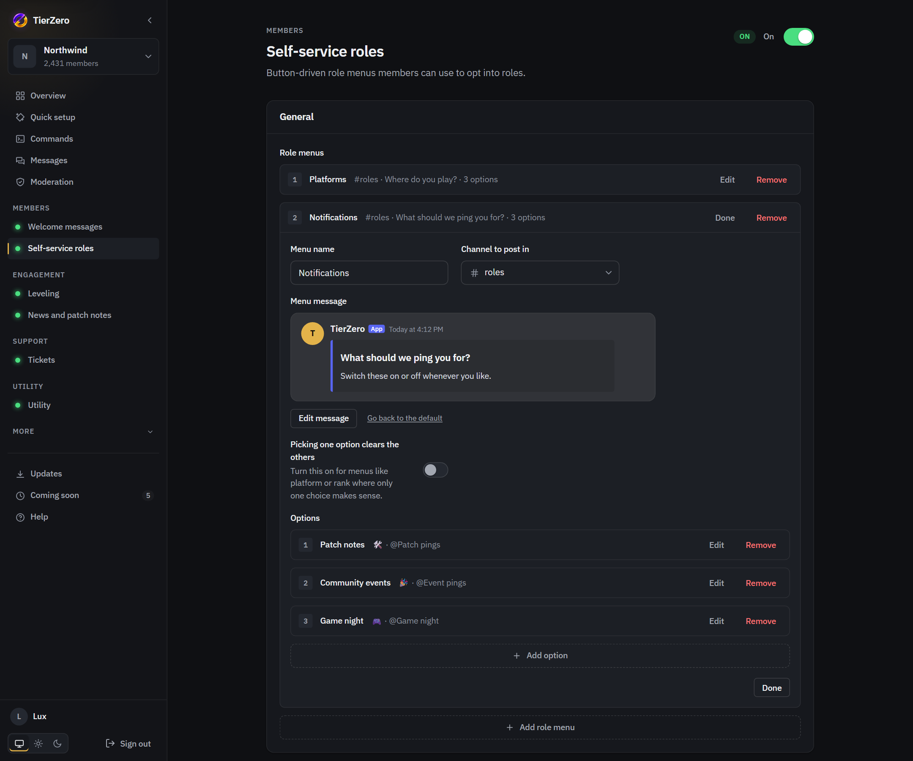

## Tickets

Members open a ticket from a panel: a message with buttons, or a menu, that you post in a channel. Each button or menu option is a **ticket type**, such as Support, Billing or Reports, and each type has its own **handlers** (the roles that work its tickets), its own questions, category, first message and rules. A server can have several panels. A server set up before types existed keeps working as one panel with one type called Support, with the same button, question, category and roles it had.

A ticket is a private channel, or a private thread under the panel's channel if the type is set to open threads. A channel denies the whole server and lets back in the opener, the type's handlers, your admin roles, any observer roles, roles with Manage Server or Manage Channels, and the bot, whatever other roles anyone has. A thread adds the opener, then up to 50 members holding the handler, admin or observer roles, handlers first. Threads need no category and have no channel limit.

Each ticket has a number counted per server, starting at 1, which is what members and staff see: `#12` in messages, in the dashboard and in transcript files. Tickets from before this was added were numbered in the order they opened.

### Opening a ticket

When a member picks a type, the bot checks, in this order: the blocklist under **General**, the roles allowed or blocked for that type, how many of that type they already have open, and the wait between tickets if the type has one. For a channel type it then needs room in the type's category. Discord allows 50 channels in one, and once it is full, or if it is not set or was deleted, new tickets go to the **Overflow category** if you set one. If anything stops the member, they're told why, privately.

A type can ask up to five questions in a form before the ticket opens. The answers are shown under the first message (switch off **Show the answers under the first message** to hide them), and the first answer becomes the ticket's subject. A type with no questions opens straight away.

The first message pings the roles chosen under **Who to ping when a ticket opens**: the handlers, other roles, or nobody. The starting first message names them with `{pingRoles}`, so changing the choice changes who is pinged without editing the message. A thread always pings the handlers too, which lets in any the bot could not add itself.

The channel name pattern can use `{username}`, `{type}` and `{number}`. Letters of any alphabet are kept, so a member named in Cyrillic or Japanese gets a channel named after them.

Under **Automation**, **Working hours** sets when the team answers, as rows of a day and a time, in the time zone you give (UTC when empty). A ticket opened outside them gets a message under its first one saying when the team is back. With no rows, every time counts as working hours. The bot adds a **Close ticket** button and a **Claim** button under it. A type with claiming switched off gets only the Close button.

### Setting up a panel

In **Settings**, under **Panels**, each panel is one row. Its header says where it stands in Discord, such as Posted in #support or Not posted yet. Click **Edit** to open it. A panel has three steps, numbered in the order you do them.

1. **Where it goes.** The panel's name (only you see it, it tells panels apart), the channel it is posted in, and **Members open a ticket with** Buttons or Menu. The menu's grey placeholder text only shows up once you pick Menu.
2. **What members see.** The panel message exactly as it looks in Discord, with its buttons or menu under it. **Edit message** changes the text. Click one of the buttons to change just that button.
3. **Ticket types.** One card for each button or menu option. A card shows the emoji and name, a dot in the button's colour, the roles that handle it, how many questions it asks and whether its tickets are private channels or private threads. A type with no handlers, or no category, says so in amber on its card. The arrows change the order. **Add ticket type** adds another, and a panel can have 25.

At the bottom of the panel, the status line says whether it is up in Discord and the main button puts it up: **Post to Discord** the first time, **Update in Discord** after you change it, **Post again** if the message was deleted. It posts what you saved, so it asks you to save first when you have unsaved changes. **Check again** asks Discord whether the message is still there. Before it posts a panel with a type that cannot open tickets yet, it says which type and why and asks you to confirm. **Collapse panel** folds the panel up. The three dots in the panel's header hold **Duplicate** and **Remove**. Removing asks first, and nothing changes until you save.

### Editing a ticket type

**Edit** on a type's card opens a panel from the right with the type's name and emoji at the top and five tabs. Close it with the X, **Close**, the Escape key, or by clicking outside it. Everything you change stays in your unsaved changes, so closing it loses nothing. Save from the bar at the bottom of the page, as with any other setting. A small dot on a tab means something there needs you: amber for something missing, such as no handlers, red for a setting the bot refused. If a save is refused, the panel opens on the tab with the problem.

- **Basics.** The type's name and emoji, the button's text and colour, the menu description, and where its tickets open: a private channel or a private thread, the category and an overflow category for channels, and the channel name.
- **People.** The **Handlers**, who answer these tickets. Then the observers, who to ping when a ticket opens, the roles that may open this type and the roles that may not.
- **Form.** The questions asked before the ticket opens. Add, reorder and remove them. **Preview the form** shows them the way Discord does.
- **Messages.** The first message in the ticket, with the buttons the bot adds under it, and whether the answers are shown under it.
- **Rules.** How many tickets of this type one member can have open, the wait between tickets, whether staff can claim, whether the opener can close their own ticket, whether closing asks for a reason and whether only staff can reopen. Below those are the settings that differ from the general ones: when inactive tickets close, the transcript channel and whether the opener is asked for a rating.

**Remove this ticket type** is at the bottom of the panel and asks first. **Make a copy** adds a copy of the type right after it.

### The panel's buttons

In step 2 of a panel, the preview of the panel message shows what members see under it: one button per ticket type, five to a row, or a menu holding every type when **Members open a ticket with** is Menu. Click a button, or an option of the menu, to change it right there:

- **Button text** (or **Option text** in a menu). Leave it empty to use the type's name. Discord allows 80 characters on a button.
- **Emoji**, a normal emoji or a custom one written as `<:name:id>`.
- **Colour**, one of blurple, grey, green or red, for a button. A menu option has a **Description** instead, the quieter line under its text.
- **Move left** and **Move right** (up and down in a menu) change the order.
- **All settings for this ticket type** opens the type's panel from the right.

Clicking the menu itself changes its placeholder, the grey text shown before anything is picked. Left empty, Discord shows "Make a selection". Types are added in step 3, below the preview. A panel can have 25 types, which is as many buttons or menu options as Discord allows on one message.

These edits are part of the settings like any other, so they're kept when you press **Save changes**. To change the panel in Discord, post it or update it with the button at the bottom of the panel.

The buttons the bot adds under its own messages are shown and edited the same way: Close ticket and Claim under the first message of a type, and in the Messages part, Reopen and Delete ticket under **Closed, channel kept** and Close and Keep open under **Asked to close**. Click one to change its text and its colour.

### Working a ticket

Everything here is under `/ticket`. Staff are the type's handlers, your admin roles and anyone with Manage Channels or Manage Server. The dashboard counts them the same way: Manage Channels works every type's tickets there too, but only Manage Server opens Settings.

- `/ticket claim` or the Claim button marks you as handling it, and the button turns into Unclaim. A handler can't take over or drop someone else's claim, but an admin can. Switch on **A claim stops other handlers writing** under General and the other handlers can still read a claimed ticket but not send messages in it. They can still close it, move it and change its priority and members. This works in channels only, as threads have no per-role permissions.
- `/ticket priority` sets low, normal, high or urgent. The priority shows in the channel topic.
- `/ticket rename` renames the channel. Discord only allows two renames in ten minutes, so a third one waits its turn: the bot says so, and it goes through by itself within ten minutes.
- `/ticket transfer` moves the ticket to another type. Its handlers, observers and category become the new type's, the claim is dropped and the new handlers are pinged.
- `/ticket add` and `/ticket remove` let a member in or take them out. The opener can add people too. Only staff can remove them, and the opener can't be removed.
- `/ticket reply` sends one of the server's **Saved replies** in the ticket, under your name, with `{user}`, `{staff}`, `{number}`, `{type}` and `{ticket}` filled in. Start typing to pick one. Saved replies are set up in their own part of Settings.
- `/ticket note` adds a note only staff can read, in the dashboard. Nothing is posted in Discord.
- `/ticket info` shows the ticket's type, priority, opener and who is handling it, to staff and the opener.
- `/ticket transcript` gives staff a link to the ticket in the dashboard, once the bot knows the dashboard's address.
- `/ticket panel` posts every panel, or the one you pick. If a panel is already posted in its channel, the message is updated in place instead of posting a second one.

Each part of `/ticket` can be switched off or limited to roles and channels on its own, on the Commands page or in the Commands part of the ticket settings. See [Commands](#commands).

### Opening a ticket as staff

Staff can start a ticket instead of waiting for one, for example when they need to talk to a member. In the Inbox, press **New ticket** (or `n`) and fill in:

- **Type.** Managers and admin roles can pick any type. A handler can pick the types they handle. A type that can't take tickets right now, such as one whose category is full, says why and can't be picked.
- **Subject**, if you want one.
- **Form answers**, folded away. The type's questions are optional here, and anything you answer shows in the ticket as it would for a member.
- **Members to add.** Search by name and pick up to 10. The search matches any part of a username, display name or nickname, ignores case, accents, spaces and underscores, and also takes a pasted user ID or mention. They need to be in the server and can't be bots. They get access the same way as with `/ticket add`, and they are mentioned in the first message.
- **First message**, if you want one. It is posted in the ticket under your name as soon as it opens.
- **Notify the handlers**, off unless you tick it. The ticket's first message names you as text and does not ping you, and the roles that handle the type are only pinged when this is ticked. A thread ticket always notifies them, since a private thread only lets in the roles its first message mentions.

Press **Open ticket** and the dashboard takes you to it. You are the ticket's opener, so it counts as yours in the lists. The rules a member has to pass don't apply: the blocklist, the roles allowed to open the type, the limit on open tickets, the wait between tickets and working hours. The category still has to exist and have room, and thread types still open a thread. Nobody is asked to rate it, and it isn't closed or flagged if you leave the server.

### Closing

The Close ticket button and `/ticket close` close a ticket. The opener may close their own unless the type says otherwise, and a type can ask for a reason in a short form first. `/ticket request-close` asks the opener instead. They get Close and Keep open buttons, and if they don't answer within the time set under General, the ticket closes by itself.

What happens to the channel is up to you, under **When a ticket closes**:

- **Delete the channel**, as before. The transcript is what remains.
- **Lock and keep the channel**. Members can still read it but not write, and it moves to the closed category if you set one. A thread is locked and archived. The closed notice has Reopen and Delete ticket buttons, and the channel is deleted after the number of days you set (0 keeps it until staff delete it). A kept ticket can be reopened with the button or `/ticket reopen`. The opener can reopen it too unless the type leaves that to staff, as long as they could open a ticket of that type now: the blocklist, the type's roles and its limit of open tickets apply. The wait between tickets does not, since nothing new is opened. A change to the number of days applies to channels already kept.

If someone deletes a ticket's channel in Discord, the ticket is marked closed.

When the member who opened a ticket leaves the server, **When the opener leaves the server** under General decides what happens: say so in the ticket (the default, which also marks the ticket in the dashboard), close it, or do nothing.

### Transcripts

While **Keep transcripts in the dashboard** is on, every message in an open ticket is saved as it's sent, edited or deleted, so the transcript doesn't depend on the channel still being there. When a ticket closes the bot also reads the channel's last 500 messages and saves any it missed, for example while it was offline. Messages are saved the way Discord shows them: formatting, mentions, custom emoji, embeds, buttons, replies and stickers. Reactions are saved when the ticket closes. Tickets closed before an update keep what was saved for them then, so an older transcript can look plainer or have no messages at all. Attached files stay on Discord and only links to them are saved, so a file deleted on Discord is gone from the transcript too. Set **Delete saved messages after this many days** to clear old transcripts. The ticket itself and its details stay. A manager can also delete one transcript by hand; the ticket then records who deleted it and when, so the two can be told apart.

When a ticket closes, the bot can also post the transcript file to the log channel, send the transcript by direct message, and post a short summary of the ticket to the log channel. The summary has a View in dashboard button once the bot knows the dashboard's address. A type can send its transcripts to a channel of its own.

**Send the transcript to** decides who gets the direct message: nobody (the default), only the opener, or everyone in the ticket who is not staff. That is the opener and the members added to the ticket, leaving out bots and anyone who is a handler, observer or admin of the ticket's type or who can manage channels or the server. Someone with direct messages closed is skipped, and the ticket still closes. The file is the same web page the dashboard's Download as web page gives, named from the file name under Buttons and form text with .html at the end. **Format of the file sent** can switch that to a text file or send both. The web page is built from the saved messages, so with Keep transcripts in the dashboard off a text file is sent instead. The log channel still gets the text file. A server that had **Send the transcript to the opener** on keeps it as Only the opener.

### Ratings and reminders

With ratings on, the opener gets a direct message after the ticket closes with buttons from 1 to 5. When the transcript is also sent to the opener, the request is in that same message, under the file. Picking a rating saves it, takes the buttons off the message and shows the rating under the original text, for example "You rated this 4 out of 5" with stars. The wording of that notice is **Rating DM after a rating** under Ratings and reminders. Picking one also opens a short form for an optional comment. The thanks message is sent when that form is sent; closing the form keeps the rating without a thanks. Only the first rating counts, and a second try says it was already rated. A type can switch ratings on or off for itself.

Under **Automation**, auto-close closes a ticket nobody has written in for the time you set, and the clock starts again whenever someone writes. A type can use its own time or never close by itself. Changing these, or moving a ticket to another type, applies to the tickets already open, counted from their last message, and switching auto-close off stops the closes already planned. The staff reminder pings the handlers once if nobody but the opener has written after the time you set. Every one of these times is at least a minute.

### Replies from the dashboard

Staff can answer a ticket from the dashboard. The reply is posted in the ticket under their Discord name and avatar, through a webhook the bot creates in the channel. Without Manage Webhooks the bot posts it itself, with the staff member's name in bold on the first line. A reply can ping the people in the ticket and its handler and admin roles, never `@everyone`, `@here` or any other role, and a hint under the box says so.

**Reply** appears on a message in the conversation when you point at it, beside the **...** button, and in the message's right-click menu. It puts a bar above the box saying **Replying to** the author and the start of what they wrote. Select the bar to scroll to that message, **X** or Escape to drop it, and a reply that sends clears it. In Discord the reply starts with a small grey line, ↩ and the name and the first words, that links to the message. A webhook can't make a real Discord reply, so the line stands in for it. The line never pings anyone. When the bot has to post the reply itself it is a real reply and doesn't ping the author. The dashboard's conversation and the transcripts show it the way they show a reply made in Discord. A message that was deleted in Discord can't be replied to. **Shift+R** replies to the member's latest message.

Under the box, **Saved replies** lists the server's saved replies. Search by name or text, pick one with the arrow keys and Enter, and it goes into the box at the cursor with `{user}`, `{number}` and the rest already filled in, ready to edit before sending.

**Attach** adds files, and files can also be dropped on the box or pasted into it, such as a screenshot. A reply carries up to 10 files and 8 MB in all. A file that would break either limit is left out, with a line saying which and why, and the rest are kept. A bar shows the upload, and a failed send keeps the text and the files. Leaving a half-written reply asks first.

**Add embed** opens the same embed builder the Messages page uses, with a preview of how Discord will draw it. A reply carries up to 3 embeds, and each shows as a chip under the box that you can click to edit or remove. Together they can hold 6,000 characters, which is Discord's limit, and the dialog says how much is left. Links and pictures must be web addresses. A reply can be only an embed or only files, with no text. Buttons, menus and reactions are not offered, since a reply can't carry them. Anyone who may reply may add embeds.

The same dialog has a **From saved messages** tab. It lists the templates from the Message creator that are marked **Available in tickets**, grouped by folder, with a search box and a preview of the message as it will look in this ticket. Pick one and press **Add to reply**: its embeds go in as chips you can still edit, with `{user}`, `{number}`, `{server}` and the other variables filled in for this ticket. Tick **Also use its text** to put the message's text in the box too. Buttons, menus and reactions are dropped, and the dialog says so. The usual limits apply, so an embed that would take the reply over 3 embeds or 6,000 characters is left out, with a line saying why.

Under **General**, **Replies from the dashboard** sets who a reply looks like it is from. The default is **The staff member**, as above. Choose **A team name** and every reply goes out under one name and picture, so members see the team and not who answered. **Team name** starts as Support Team. **Team picture** is a link to an image, and without one replies use the bot's picture. **Add who replied as a small line** adds a line such as `Sent by Kairo` at the end of each reply, in Discord's small grey text. **Wording of that line** changes the text. `{user}` is a mention of the staff member, so clicking it opens their profile, and `{name}` is their name as plain text. It starts as `Sent by {user}`. The mention never notifies them. Without a webhook the team name is the bold first line instead.

Whichever you pick, the dashboard keeps who really sent each reply. The conversation shows the team name with a small `sent by Kairo` beside it, and the ticket's history and first-response time still count the person. Transcripts show what Discord showed, so a team reply names the team, and names the person only if the line was switched on. A reply sent from the dashboard shows a `via dashboard` tag next to the name, and it is never grouped under a message the same person typed in Discord.

### The ticket workspace

Tickets has its own section in the dashboard with four tabs. Who sees what depends on who they are. Anyone with Manage Server, and the instance owner, sees everything, including **Settings**. Someone holding a handler role sees the tickets of the types they handle and nothing else. A role listed under **Admin roles** in General sees and works every ticket but has no Settings tab. A handler who can't manage the server doesn't need to be listed anywhere else, because the bot reads their roles from Discord each time. The server shows up for them on Your servers and in the server switcher, marked Tickets, and opens straight on the Inbox.

- **Inbox** lists open tickets with a search box and filters for type, priority and whether a ticket is yours, unclaimed or anyone's. **My queue** shows the open tickets you claimed or answered first. A blue dot marks a ticket where the member wrote last and nobody has answered, and the time on each row is its last activity. Pick one to read the conversation, which updates as things happen while the tab is open, usually within a second. The same goes for a claim, a priority, a note or a new member someone else adds. The side panel shows the opener, their answers, who is in the ticket, a timeline of what happened, and **internal notes**, which only staff see and are never sent to Discord. From the header you can claim, change the priority, move the ticket to another type, ask the opener whether it can close, close it and reopen it. The channel can be renamed from **Rename** beside its name in the side panel. Tickets are shown by their per-server number everywhere.
  - **Live list.** While the tab is in front, the list hears about changes as they happen. New tickets wait behind a **N new tickets** button instead of moving the rows while you read; other activity, such as a member writing or someone closing a ticket, brings the list up to date by itself once the pointer and keyboard focus are out of it. The browser tab's title starts with how many tickets are waiting on staff, as in `(3) Tickets`. **Desktop alerts** is a button, off until you press it and your browser asks: while it is on, a tab in the background checks once a minute and shows an alert when a ticket opens or another one starts waiting on staff. The choice is kept per server in that browser only.
  - **Keyboard.** `j` and `k` open the next and previous ticket, `c` claims the open ticket, `r` goes to the reply box, `Shift+R` replies to the member's latest message, `n` opens the New ticket dialog, `/` goes to the search box and `?` lists them. They do nothing while you are typing in a box.
  - **New ticket.** The button at the top of the list opens a ticket yourself, for when staff need to talk to someone. See [Opening a ticket as staff](#opening-a-ticket-as-staff).
  - **Adding people.** **Add** in the People list finds a member by name. Pick one from the results, or type a name and press Enter to add the one member who has it. The member must be in the server.
  - A ticket whose opener has left the server says so above the conversation, with when. A thread ticket names the channel it sits in and links to it.
- **Transcripts** is the archive of closed tickets, with the same search plus rating and handler filters. Select a row, or **Read**, to open its transcript. It looks like the ticket did in Discord, in Discord's dark colours, with the channel's name at the top. Deleted messages stay visible to staff, dimmed and marked. **Show ticket activity** adds claims, priority changes and the like between the messages, in a style of their own; staff notes are only in the side panel. A closed ticket in the Inbox shows the same view and has an **Open transcript** button. A transcript downloads as a web page that looks the same, with times in UTC, or as a text file. Next to each row, the download button opens a small menu with both. If the messages are gone, the page says whether a manager deleted them, naming who and when, or the retention period ran out, and offers no downloads. Discord's own font isn't free to share, so the transcript uses a close substitute. A manager can delete a transcript, which removes the saved messages and leaves a line in an audit record.
- **Stats** shows tickets open now, opened and closed over 7, 30 or 90 days, the median time to a first answer and to close, ratings, and a breakdown by type and by handler. The name of a type or handler opens the list of their tickets.
- **Settings** is the same settings form as the other features, split into Panels, General, Transcripts, Ratings, Automation, Saved replies and Messages. The Panels part has a **Health** card, then the panels. Each panel's header says where it stands: posted, changed since it was posted, still up in a channel it was moved from, deleted in Discord, posted by the older version, or not posted. The button at the bottom of an open panel (see [Setting up a panel](#setting-up-a-panel)) puts it up from the settings you saved, and moves it if its channel changed, taking the old message down. Before it posts a panel with a type that cannot open tickets yet, such as one with no category, it says which type and why and asks you to confirm. The Health card lists what would stop tickets working: a missing category, a full one, a deleted panel message, a custom emoji from another server, a type with no handlers. Its heading says how much is wrong, such as one ticket type of eight, and each item opens the panel or type it is about. **General** has **Blocked members**, which finds members by name. The Commands part has the `/ticket` switches.

A server with nothing set up yet sees three steps at the top of the Inbox and of Settings, and **Quick setup** (see [Quick setup](#quick-setup)) is the shorter way through them.

Replies and every action in the workspace go through the same code as the slash commands, so the two never disagree. Nothing in Discord depends on the dashboard, so a server that never opens it loses nothing.

### Messages and labels

Every message the bot sends about a ticket is edited with the message builder and starts as what the bot posts now. The panel is step 2 of its row under **Panels**, and the first message of each type is on the Messages tab of that type. Everything else is in **Messages**, under **What the bot says**: one list, in the order a ticket meets them.

- **When a ticket opens**: the reply the opener sees with a link to their ticket.
- **While a ticket is open**: claimed, unclaimed, priority changed, moved to another type, renamed, member added and removed, asked to close and kept open.
- **When a ticket closes**: closing, closed with the channel kept, reopened, the transcript post, the transcript sent to the opener and the closed ticket summary.
- **Ratings and reminders**: the rating request, the notice shown after a rating, the thanks and the reminder to staff.
- **Commands the team runs**: what `/ticket panel`, `/ticket note`, `/ticket transcript` and `/ticket info` reply.
- **When something goes wrong**: the refusals and errors, folded into **Not allowed**, **Cannot open a ticket** (including the blocklist, the wait between tickets and the roles a type allows) and **Cannot do that right now**. Click one to open it.

Each row says when the message is sent and who sees it: **Public** for everyone in the channel, **Only them** for the person it answers, or **Direct message**. Beside that is the start of what it says now, with variables shown as small tags, and whether it is the **Default** or **Customised**. **Edit** opens the message builder and **Reset** goes back to the default. The search box looks through the names, the when lines and the wording, and **Customised only** shows just the ones you changed. A message whose switch is off, such as the transcript post while posting the file is off, says it isn't sent for now. The transcript, rating and reminder messages are also with their own settings, and an edit in either place is the same edit.

The buttons and menus the bot adds itself aren't part of those messages. Close ticket and Claim show under the first message of a type, Reopen and Delete ticket under **Closed, channel kept**, and Close and Keep open under **Asked to close**. Click one to change its text and colour (see [The panel's buttons](#the-panels-buttons)). The rating buttons are always 1 to 5.

Variables in the first message, besides the ones every message has: `{user}`, `{username}`, `{subject}`, `{title}` (the subject, or "New ticket" when there is none), `{number}`, `{ticket}`, `{supportRoles}`, `{type}`, `{priority}`, `{answers}` (every answer as a list), `{answer1}` to `{answer5}`, `{claimedBy}`, `{handlers}`, `{pingRoles}` and `{members}` (the members added to the ticket, as mentions, empty when nobody was). Only the roles picked under **Who to ping when a ticket opens** are pinged, and `{pingRoles}` names them, so keep it in the text. `{answers}` and `{answer1}` to `{answer5}` are cut to 1000 characters, and the answers shown under the first message are shortened to fit Discord's limits, so long answers never replace your message with the starting one. The first message is filled in again when the ticket is claimed or moved, so `{claimedBy}` and `{type}` stay current. Each message lists its own variables in the editor.

**Buttons and form text**, below the messages, holds the short strings that go to Discord rather than being sent as a message. Each one has a **Reset** link once you change it.

- **Buttons**: the text and colour of Close ticket, Claim, Unclaim, Reopen, Delete ticket, and Close and Keep open on a close request.
- **Forms and channels**: the form title, the form that asks why a ticket is closed, the channel topic with and without a subject (`{tag}`, `{username}`, `{subject}`, `{type}` and `{priority}`), the names of the priorities, the reason Discord's audit log records when a ticket closes (`{tag}`), and the name and reason used for an automatic close.
- **Transcript file**: the file's name and every line of its wording.

The channel name pattern is under **General**, and a type can have its own.

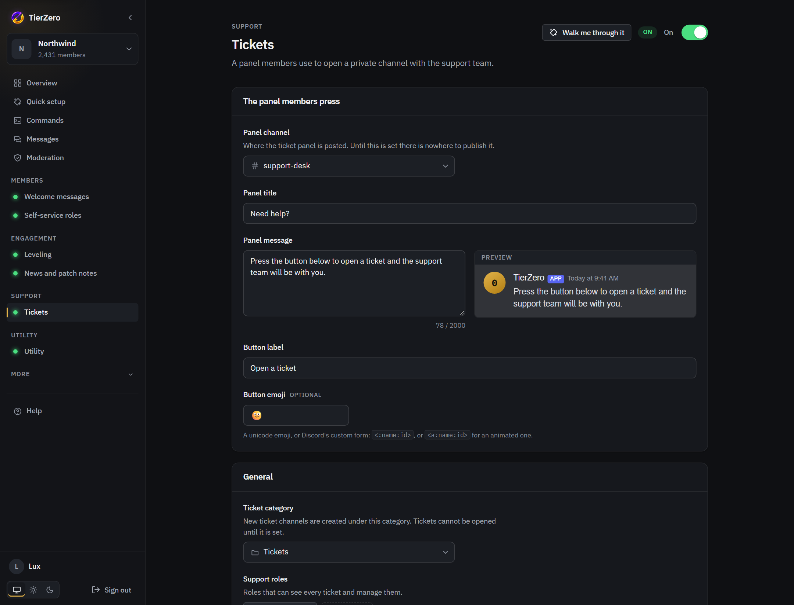

## Log channel

Found under **More** in the sidebar, since most servers use [Server logs](#server-logs) instead. Posts what changed on the server into a channel you pick, so staff who stay in Discord see it as it happens. It doesn't keep anything searchable. It posts: message edits and deletions, joins and departures, nickname and role changes, channels and roles created and deleted, bans and unbans, kicks, timeouts and timeouts lifted early, members joining, leaving and moving between voice channels, invites created and deleted, threads created, deleted and archived, emoji and stickers added, changed or removed, and changes to the server's own settings (name, description, icon, banner, verification level, inactive channel and timeout, system and rules channels, owner). Every category has its own switch. Kicks and timeouts are on from the start, like the original kinds. Voice, invites, threads, emoji, stickers and server settings start off, since they can be busy. A kick is read from the server's audit log, so it needs the bot to have View Audit Log, and a kicked member also gets the usual departure entry. A timeout that runs out by itself isn't posted, only one lifted early. Entries for messages the bot never cached say what's known and leave out the rest. An edit that didn't change the text, like a link preview loading, is skipped. The log channels aren't logged about themselves, and bot messages and bots in voice are skipped unless you switch on **Log what bots do**. **Channels to ignore** takes text, voice and forum channels, and covers the threads inside them too, as well as voice activity and invites for those channels.

Everything goes to the log channel unless you open **Separate channels** and give a kind of entry a channel of its own: message deletions and edits, members (joins, departures, nicknames and role changes), channels and roles created or deleted, bans, kicks and timeouts, voice channel activity, invites, threads, emoji and stickers, and server setting changes. A kind left empty still goes to the log channel.

Every kind of entry has its own message under **How each entry looks**, edited with the same message builder as everywhere else, and it starts out as the entry the bot posts today. Each one has variables for what happened, such as `{author}`, `{content}`, `{before}` and `{after}` for messages, `{member}` for joins, departures, bans, kicks, timeouts and voice, `{reason}` for a ban or a kick, `{moderator}` for a kick, `{until}` for a timeout, `{channel}`, `{from}` and `{to}` for voice, `{invite}`, `{inviter}`, `{uses}` and `{expires}` for invites, `{thread}` and `{owner}` for threads, `{emoji}` and `{sticker}`, `{changes}` for server settings and stickers, `{new.channel}` and `{old.channel}` for channels, and `{new.role}` and `{old.role}` for roles. The editor lists them for each entry. A line whose variable is empty is left out, which is how a ban with no reason has no reason line, and how a nickname change doesn't show the role lines. Nickname and role changes share one entry. Put the variables in the embed rather than the message text: text from a deleted or edited message can contain mentions, and an embed never pings anyone. Which events are posted is still chosen with the switches, not by the messages.

When the bot doesn't know something, it writes a stand-in into the variable. Under **Labels and text** you can reword all five: the author of a message the bot never saw ("Unknown (not cached)"), a deleted message it couldn't read ("Unavailable (message was not cached)"), the text before an edit it never saw ("Unavailable (not cached)"), the text after an edit that has none ("Unavailable"), and a member with no nickname ("(none)").

## News and patch notes

Posts what's new from sources you can't follow with Discord's Follow button.

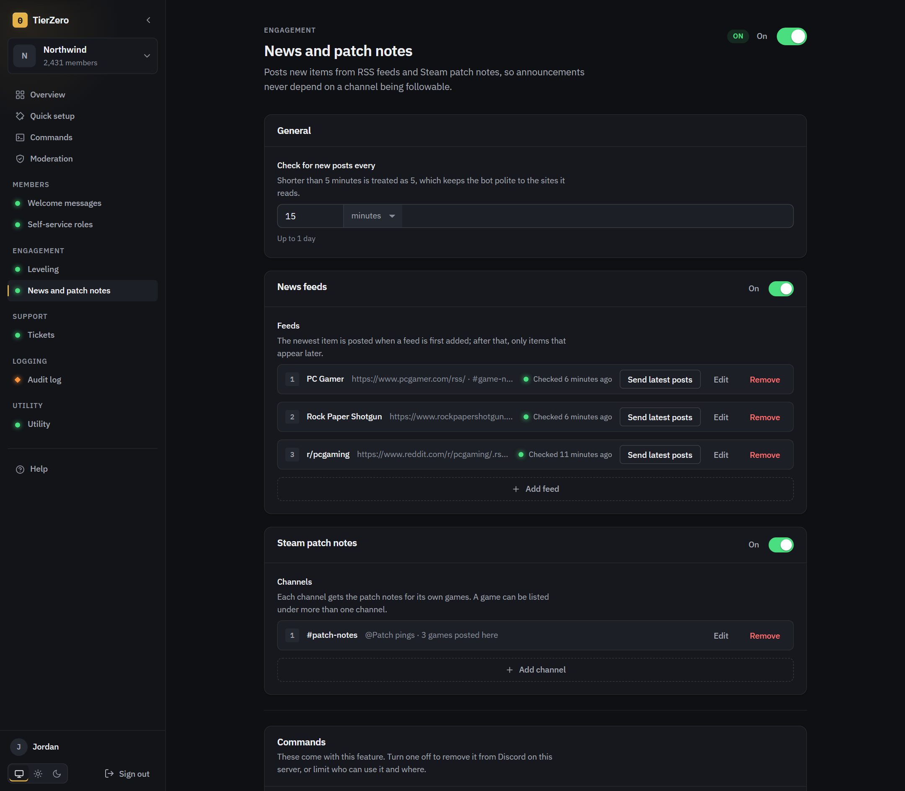

**News feeds** take any RSS or Atom address, a subreddit with `.rss` added, or the address of a site or a YouTube channel or playlist page, in which case the bot reads the feed the page links to. YouTube needs no account or key for this. An address without `https://` gets it added, and anything that isn't a web address is refused when you save. Each feed has its own channel, an optional name above the post, and an optional role to ping. The same address can be listed for more than one channel, and each gets every new item.

**Patch notes** come from Steam, per game: paste the game's store address, or just the number in it. The developer's own announcements are used, not news site reposts. Games are listed under each channel, so one channel can carry your shooters and another your RPGs, and a game can appear under several. Each post is an embed with the game's logo, name and title, with an optional ping per channel. A post counts as patch notes when Steam tags it that way or its title says so ("Patch 2.31", "Hotfix 1.2"), and announcements about an update that hasn't shipped are skipped. Per game, you choose patch notes only or every announcement.

A new source posts its newest item once, to show it works, then only new items. If a source suddenly returns a lot, such as a feed that was down for a week, at most five are posted. Sources are checked every 15 minutes by default and never more often than every 5.

- `/feeds status` shows what's watched, when each source was last checked, and why one isn't working.
- `/feeds send` posts the latest items from one feed or game now (up to ten, oldest first). Give it part of a name or address, and if that matches several sources it lists them. The scheduled checks won't repeat what it sent. Only members who can manage the server see `/feeds` by default.

The post for news items and the post for patch notes are each a message you can rewrite, under **Post** in their sections, and they start out as the embed described above. News items have `{source}`, `{title}`, `{link}`, `{description}`, `{image}`, `{published}` and `{role}`. Patch notes have `{game}`, `{game.id}`, `{title}`, `{link}`, `{description}`, `{logo}`, `{published}` and `{role}`. `{description}` is already cut to the length the bot uses (400 characters for news, 900 for patch notes), and a variable that is empty, such as the picture of an item that has none, is simply left out. The role you pick to ping is not added by itself: it arrives as `{role}`, which the starting message has as its text, so keep `{role}` in the text if you still want the ping. `{published.iso}` is the same moment in the form an embed's time setting needs. Rewriting the post applies to every feed or game. To give one feed, or one patch notes channel, a post of its own, switch on **Use a post of its own** in its row. The replies to `/feeds status` and `/feeds send` start as embeds. The answer to `/feeds send` can be reworded from the Commands page with `{posted}`, `{count}`, `{source}` and `{problem}`.

The rest of what the commands say is under **Replies and errors**, four short messages that only the person who ran the command sees: nothing is being watched, what `/feeds status` shows (`{lines}` is one line per source and `{count}` how many), nothing matches what was typed after `/feeds send` (`{query}`), and more than one source matches (`{query}` and `{sources}`). The list is cut to 1900 characters, as it always was, so the text you put around it still fits in Discord's 2000.

**Labels and text** holds the words those replies are built from. Each source's line in `/feeds status` has three forms: not checked yet (`{source}`), working (`{source}` and `{checked}`), and a problem (`{source}`, `{checked}` and `{problem}`). **Sentence for a send that stopped early** fills `{problem}` in the reply to `/feeds send` and understands `{error}`. **Problem descriptions** are the twenty short reasons a source can fail, such as the site being too slow, an address that can't be found, an address that isn't a feed, or a deleted channel, with `{status}` in the two that quote a status code. They are written down when a source is checked, so a reworded one shows up beside the source after its next check.

The messages beside each source on the dashboard, such as "Send latest posts", are not in the bot's Discord replies and keep their fixed wording.

Feed addresses are fetched from the public internet only. An address pointing at the bot's own machine or network is refused, which matters when people other than the operator can reach the dashboard.

The feature shows **Needs setup** until it has a feed or a patch notes channel.

## Leveling

XP for taking part, levels, and roles at thresholds you choose. Each message is worth a random amount inside a range you set, so nobody can count to the next level, and a cooldown means a burst of one-word messages isn't worth more than a conversation. Role rewards either stack or replace. A member who leaves and comes back gets their rewards back. A reward you add later reaches members already past its level the next time they level up, or straight away with **Give to members who qualify** on its row. A role can carry an XP multiplier, and when a member has several, only the biggest applies. Channels that earn no XP cover the threads inside them. Rank and the leaderboard are plain embeds.

Level-ups can be announced in one channel, in the channel the member was talking in, or by direct message, or not at all. Servers that had an announcement channel before keep announcing there.

Switch on **Public leaderboard** and the leaderboard gets a web page anyone with the link can open, without signing in. It lists members in order, 50 to a page, with their server name, picture and level, and nothing else. Members who have left show as "Former member". The Leveling page shows the page's exact address once it's on. That address is built from the dashboard's own address, so the dashboard has to be reachable from the internet for anyone else to open it. The address is taken from **Dashboard address** in the moderation settings, or else from the address you last opened the dashboard at, unless that was this computer only. While there isn't one, the Leveling page says so instead of showing an address. `/rank` and `/leaderboard` get a **Full leaderboard** button that opens the page, and the button is left out while the page is off or has no address. In a reply you wrote yourself, `{leaderboard.url}` is the address. Search engines are asked not to list the page unless you switch on **Let search engines list the page**. The page is refreshed at most once a minute, and anyone opening it many times in a short while is asked to wait. Names come from the members the bot already knows, and the bot asks Discord for the rest only a limited number of times a minute. When that limit is reached, a page you opened recently is shown as it was, and a page nobody has opened shows "Member" in place of names it couldn't look up. Visitors are told apart by the address your reverse proxy adds to `X-Forwarded-For`. Without a proxy in front of the dashboard they can't be told apart, so the limit on all visitors together is what protects the bot. Any member can leave themselves off the page with `/leaderboard-privacy` and **Hide me**, and come back with **Show me**. `/rank` and `/leaderboard` in Discord still show them.

`/xp give`, `/xp take`, `/xp set` and `/xp reset` change one member's experience, and their rewards follow the new level. Only members who can manage the server see `/xp` by default. There's no generated image card, since drawing one adds a native dependency that makes every install harder.

The replies to `/rank` and `/leaderboard` are edited from the Commands page, and the level-up announcement is a message under **Level-up announcements**. The announcement mentions the member above an embed so they are notified, and the empty-leaderboard replies are embeds too. Under **Replies and errors**, two more messages cover `/leaderboard` when there is nothing to show: one for a server where nobody has earned experience yet, and one for a page past the last (`{page}` is the page that was asked for). Two more are what `/xp` tells the moderator who used it: one after give, take or set (`{member}`, `{xp}` and `{level}`), and one after a reset (`{member}`). The last two are what `/leaderboard-privacy` tells the member who used it, one for Hide me and one for Show me. Under **Labels and text**, **Rank for a member with no experience** is what `{rank}` says in `/rank` for someone who hasn't earned any ("Unranked" to start with), and **Line for each member on the leaderboard** is how every row of `{leaderboard}` is written. It understands `{position}`, `{name}`, `{level}` and `{xp}`.

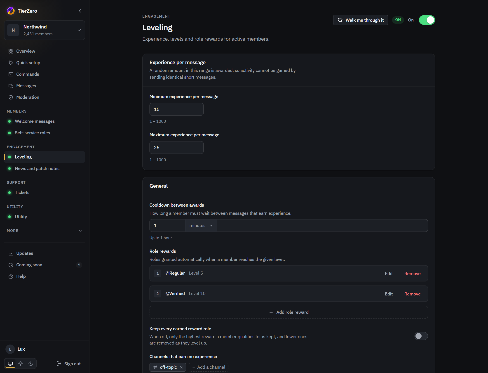

## Updates, changelog and what's coming

The **Updates** link in the sidebar opens a page with the version you are running, whether a newer release is out, the steps to update, and the changelog of every release with its notes. When a new version is out, the sidebar link gets a dot.

**Coming soon**, just above Help, opens the roadmap in a window from any page: what is planned. It is the same list as on the Updates page.

The dashboard does not apply updates itself, because that would give it the power to replace itself and run commands on your machine. The page shows the two commands to run instead. It reads releases and the roadmap from GitHub and sends nothing about your install. The owner can switch checking off on the Updates page, and then nothing is requested, and the roadmap shown is the one that came with your version.

## Gaming tools

Three features for gaming servers. Each has its own switch on the module's page, so a server can run one and leave the others off, and they all start off. The bot needs Manage Channels and Move Members for the voice rooms, and Manage Roles if a sign-up gives a role.

The wording of everything the bot says is under **Replies and errors**, and button text and the short strings Discord limits are under **Labels and text**. Times that people type, like `20:00`, are read in the **Time zone** you pick on the page. Everyone sees the posted time in their own zone.

### Join-to-create voice channels

Pick one or more voice channels as hubs. Whoever joins a hub gets a voice channel of their own, named from the hub's **Room name** (`{user}`, `{username}` and `{number}` are available), and is moved into it. The room is deleted when the last person leaves. A hub can set the category the rooms go in (otherwise the hub's own), a user limit and a bitrate. A bitrate above what the server's boost level allows is lowered to the most it allows.

Each member has one room per hub. Joining the hub again takes them back to the room they already have.

The owner changes their room with `/room`:

- `/room rename`, `/room limit`, `/room lock` and `/room unlock`. Locking lets in only the people in the room now and anyone the owner permits.
- `/room permit` lets someone in, even while it is locked. `/room kick` removes someone and stops them rejoining until they are permitted.
- `/room transfer` hands the room to someone in it.
- `/room claim` takes a room whose owner has left. A hub chooses what happens when the owner leaves and others stay: anyone can claim it, it passes to someone still in it, or the owner stays the owner.

Members with a role listed under **Roles that can manage any room** can use these in rooms they don't own. Discord only lets a channel be renamed twice every ten minutes, so a third rename inside that window is queued and the owner is told.

Who owns a room is kept by the bot, not read from channel permissions. The owner is also given Manage Channels, Move Members and the mute and deafen permissions on their room, as far as the bot holds them itself. If Discord refuses those, the room is made without them and `/room` still works. A room the bot made is deleted when it is empty, including after a restart: every ten minutes the bot goes over its rooms and removes the ones that emptied while it was away. A room is given a minute to fill before that applies.

### Looking for group

`/lfg` posts a request for players. The game comes from a list you fill in, with an optional emoji, role to ping and channel for each, and the member picks it as they type. They say how many more players they need, and may add a note and a start time.

The post shows the party, the open places, the start time and when it lapses, with **Join**, **Leave** and **Close** buttons. It is rewritten each time someone joins or leaves. The author counts as the first player. When the last place is taken the post becomes a "party full" message and loses its buttons, and the party can be pinged under it. **Make a voice channel for a full party** also gives them a room named from **Name of the party's voice channel**, owned by the author and removed once it is empty. It is given ten minutes for people to arrive.

A post closes after the time under **Close a post after**, counted from the start time when it has one. The author or anyone with Manage Messages can close it earlier with the button. Under the same settings you can set the wait between one member's posts and how many posts one member can have open. Posts are kept, so a restart loses nothing.

### Scrim and tournament sign-ups

Staff run these with `/signup`. Anyone with Manage Events or Manage Server can, and so can members with a role under **Staff roles**.

- `/signup create` posts a sign-up with a title, game, start time, team size from 1 to 10, an optional limit on teams (or players, when the team size is 1), an optional waitlist, and up to two roles one of which a player needs. A reward role can be given to everyone who is registered. It posts in the channel you name, else the default channel, else where it was run.
- `/signup close` stops sign-ups and turns the post into a closed one. **take-roles** takes the reward role back.
- `/signup list` shows who is registered and who is waiting. `/signup export` gives the same list as plain text, as a file when it is long, and can post it for everyone.
- `/signup remove` takes a player, or their whole team, off.

Players press **Sign up**. For a team sign-up, a form asks for the team name and the teammates, as mentions or user ids, and the member who filled it in is the captain. Everyone on the team needs a required role if one is set, can only be on a sign-up once, and has to be on the server. Switch off **Teams must be full** to let a team sign up short. Only the captain can withdraw a team, and staff can remove it.

When the limit is reached, new entries join the waitlist in order, and a place that opens goes to the first one waiting. They are told in the sign-up's channel, by direct message, or both, as you choose, and a direct message that can't be delivered falls back to the channel. With no waitlist, a full sign-up refuses new entries. **Remind registered players before the start** pings everyone registered in the channel that long before a start time. 0 turns it off.

## Utility

Server and member info commands: `/ping`, `/serverinfo` and `/userinfo`.

There is nothing to configure on a page of its own. Switch the feature on or off from the overview, and change any of the three replies from the Commands page like any other reply. To drop the "Joined server" line from `/userinfo`, edit its reply and delete that field. For someone who is not in the server, `{joined}` reads "Unknown" in a reply you wrote, and the standard reply leaves the line out.
