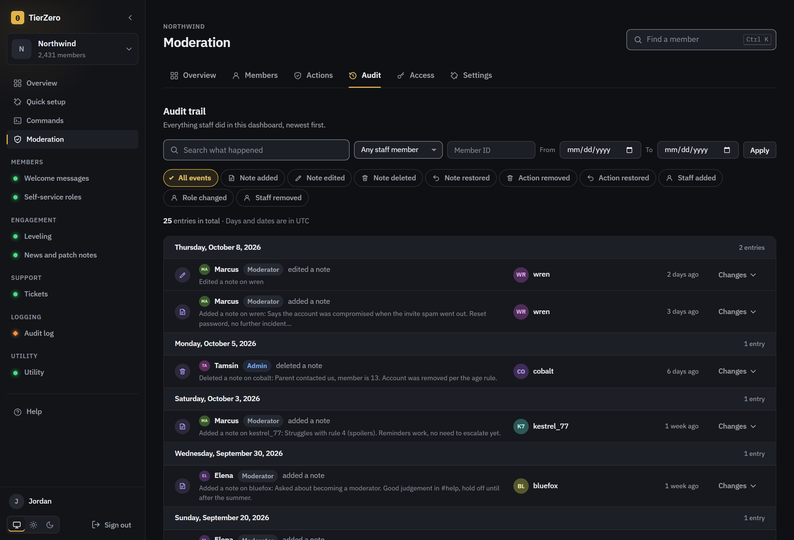
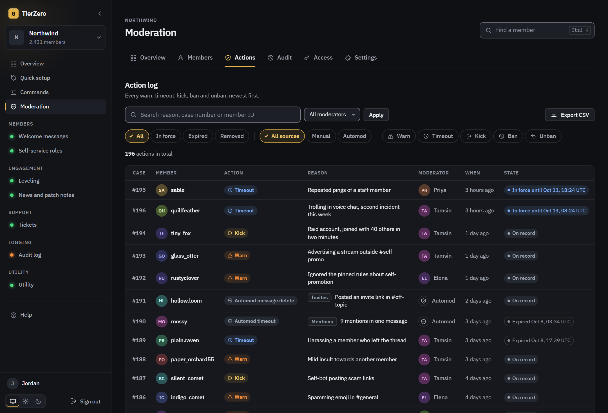

# Features

## The short version

| Feature | What it does |
| --- | --- |
| Moderation | Warn, timeout, kick, ban and temporary bans, with numbered cases and role hierarchy checks. |
| Moderation dashboard | Member records, staff notes, actions from the web or Discord's right-click menu, statistics, a log of staff activity and CSV export. |
| Automod | Seven rules: invites, links, capitals, repeated text, mentions, banned words, rate limiting. |
| Tickets | A button that opens a private channel with your staff. |
| Welcome messages | Greetings, farewells and roles on join. |
| Role menus | Members pick their roles from buttons. |
| Audit logging | Logs edits, deletions, joins, role changes and more to a channel. |
| Leveling | XP, role rewards and a leaderboard. No image cards. |
| News and patch notes | RSS feeds and Steam patch notes, posted as embeds. |
| Messages | Build a message or embed, save it as a template, sort templates into folders and send it to any channel. |
| Utility | Server and member info. |

Good to know:

- Every feature starts off. You switch them on per server, and it applies immediately with no restart.
- **Quick setup** in the sidebar gets a feature running with just the settings it needs.
- Moderators don't need Manage Server. The owner adds them under Moderation, then Access.
- Moderators can only use the dashboard if it's reachable from their devices. The [install guide](install.md#reaching-the-dashboard-from-other-devices) covers how.
- Only the owner can permanently delete a case or note. Anyone else's removal leaves a trace.

## In detail

Every feature is a module, and a module that's off does nothing. Most settings are optional. Leave one blank and that part stays quiet.

- [Quick setup](#quick-setup)
- [Commands](#commands)
- [Moderation](#moderation)
- [Moderation dashboard](#moderation-dashboard)
- [Automod](#automod)
- [Welcome messages](#welcome-messages)
- [Role menus](#role-menus)
- [Tickets](#tickets)
- [Audit logging](#audit-logging)
- [News and patch notes](#news-and-patch-notes)
- [Leveling](#leveling)
- [Utility](#utility)

## Quick setup

Quick setup in the sidebar asks only for the few settings a feature can't work without, one feature per screen, and switches the feature on at the end. **Moderation** and **Tickets** walk through several related features together, and every feature that has a quick setup is listed on its own below them.

Nothing is locked in. Settings it doesn't ask about keep their values, skipping a step leaves that feature as it was, and you can change anything later on the feature's own page. Features made of repeating rows, like role menus, have no quick setup.

## Commands

The Commands page lists every command on the server, including the right-click entries. Each one can be switched off, limited to certain roles and channels, or hidden from members without a chosen permission. You can also decide whether its reply is private or public, and for /ping, /serverinfo, /userinfo, /rank, /leaderboard, /warn, /kick, /ban, /unban and /timeout, write the reply yourself with the same editor as the [Messages](#messages) page: text, embeds, buttons, menus and variables, plus reactions on a public reply. The editor starts from what the command says now, and each command has its own variables, such as `{user}` and `{case}` for /warn. Discord can't hide a command by role, so the role list blocks use but doesn't hide it.

## Messages

The Messages page builds messages and embeds for the bot to post, such as rules, announcements or event notices. You edit on the left and see the message drawn the way Discord shows it on the right.

What you can set:

- Message text, with buttons for bold, italic, underline, strikethrough, code, spoilers and quotes.
- Up to 10 embeds. Each has a color, an author with icon and link, a title with a link, a description, up to 25 fields (inline or not), an image, a thumbnail, a footer with an icon, and a time in the footer. The time can be none, the moment it's sent, or a time you pick.
- Up to 25 buttons, five to a row. Each has a label, an optional emoji, a color (blue, grey, green or red) and an off switch that greys it out. A link button opens a web address. The others do something when pressed, which you choose.
- Up to 5 menus, each on a row of its own: a list of your own choices, or a picker for members, roles, members or roles, or channels. A menu sets how few and how many can be picked, a placeholder, whether it's off, and for a channel menu which kinds of channel appear. Each of your own choices has a label, a description, an emoji, and whether it starts picked.
- Up to 20 reactions the bot adds under the message.

A button, a choice, or a member, role or channel menu can do nothing, reply, or give or take a role. A reply is built with the same text and embeds as a message, with `{user}`, `{user.mention}` and `{selected}` filled in for the person who used it, and is private by default. A role action gives the role, takes it away, or toggles it, and can say something back. The bot can only change roles below its own highest role.

What a message's buttons and menus do is saved when the message is sent, so editing the template later doesn't change a message that's already out.

Above each text box there are tools to insert:

| Tool | What it adds |
| --- | --- |
| Variables | A name in braces that the bot fills in when it sends: `{server}`, `{members}`, `{channel}`, `{channel.name}`, `{date}`, `{time}`, `{now}`, `{sender}` and `{bot}`. The preview fills them in with stand-ins. |
| Time | A Discord timestamp. You pick a date, time and style (short time, long date, relative and so on), and each reader sees it in their own timezone. |
| Mention | A role, a channel, @everyone, @here, or a member by user ID. |
| Emoji | Your server's custom emoji and a set of common ones. |

Name a message and press Save to keep it as a template. Folders group templates, one level deep. Deleting a folder moves its templates out and deletes nothing.

Send posts it to the channel you pick, after a confirmation that shows the message once more. The bot needs View Channel and Send Messages there, and Embed Links for an embed. Each send has its own options: send under another name and picture (through a webhook, which needs Manage Webhooks in that channel), send silently, pin it, publish it to followers of an announcement channel, hide link previews, read it out loud, start a thread on it, and reply to a message. These are chosen when you send and aren't saved with the template.

A sent message can mention people and roles. @everyone and @here only ping when you turn on "Let @everyone and @here ping" for that send, and Discord still ignores them unless the bot has the Mention Everyone permission.

## Moderation

Warnings, timeouts, kicks, bans and temporary bans. Each gets a numbered case you can look up later.

- **Role hierarchy is checked before anything is sent to Discord.** A moderator can't act on someone whose highest role is at or above theirs, the bot can't act above itself, and nobody can act on the server owner. You get a refusal that says why.
- **A temporary ban schedules its own unban.** It's stored in the database, so a restart doesn't leave someone banned. Unban by hand first and the pending one is dropped.
- **Discord's limits apply.** Timeouts cap at 28 days, and bulk delete can't touch messages older than 14 days.
- **Cases outlive the action.** Unbanning keeps the row, marked inactive.

A case that staff removed in the [moderation dashboard](#moderation-dashboard) is hidden from `/history` and `/case`. The row stays in the database and shows in the dashboard, marked as removed.

## Moderation dashboard

The Moderation area in the sidebar is where staff read a member's record, leave notes, take back a mistaken action and see how moderation is going. It shows the cases the moderation and automod features record, so there's nothing extra to switch on.

| Tab | What it's for | Who sees it |
| --- | --- | --- |
| Overview | Statistics | Staff |
| Members | Everyone with something on file | Staff |
| Actions | The log of every case | Staff |
| Audit | What staff have changed | Admins and the owner |
| Access | Who can use all of this | The owner |
| Settings | Moderation and Automod settings | Anyone with Manage Server |

A search box in the header finds a member from any tab. Press Ctrl+K (Cmd+K on a Mac), or `/` when you're not typing in a field.

### Who can use it

- **The owner of the install** is the first account that signed in, or the user ID in `INSTANCE_OWNER_ID`. The owner can use Moderation on every server the bot is in.
- **Everyone else** can use it only on servers where the owner has added them, as a Moderator or an Admin. The owner does that on the Access tab, by name or Discord user ID, even before the person has opened the dashboard.
- **Manage Server** doesn't make someone staff. It opens the Settings tab and nothing else under Moderation. Being staff doesn't give access to a server's settings either.

| Permission | Moderator | Admin | Owner |
| --- | --- | --- | --- |
| Read member records and statistics | Yes | Yes | Yes |
| Write notes | Yes | Yes | Yes |
| Warn, time out, end a timeout | Yes | Yes | Yes |
| Edit a case | Their own | Any | Any |
| Take a warn or timeout off a record | Yes | Yes | Yes |
| Kick, ban, unban | No | Yes | Yes |
| Read staff activity, export member actions as CSV | No | Yes | Yes |
| Open the server logs | If the owner allows it | Yes | Yes |
| Delete the server logs | No | Yes | Yes |
| Edit or delete others' notes, restore deleted notes | No | Yes | Yes |
| Put a removed action back | No | Yes | Yes |
| Take a kick, ban or unban off a record | No | No | Yes |
| Purge an action or note permanently | No | No | Yes |
| Choose who has access | No | No | Yes |

Anyone can edit or delete their own notes.

### Member records

The Members tab lists everyone with an action or note on file. You can filter to members who are restricted right now, have notes, or were acted on in the last seven days. A member's page shows their roles, join date and account age, and a timeline of actions, notes and (for admins and the owner) staff activity, each labeled with what it is.

Notes are for staff only. Members never see them and the bot never sends them to Discord. A note is up to 2,000 characters and a member can carry 200.

Nothing disappears from the timeline when it's removed. A removed action or deleted note stays in place, marked with who removed it and when. Admins and the owner can still read a deleted note. A moderator sees that it was deleted and by whom, but not the text.

### Taking action

The **Take action** button on a member's page offers what your level allows, and only what fits the member. Unban shows for someone banned, Clear timeout only while a timeout is running. Each choice opens a short form with a reason (up to 500 characters, and required if the Moderation setting says so) and, for timeouts and bans, a length. A ban can also delete up to 7 days of the member's messages.

Warns, timeouts, kicks and bans also have an **Attach messages** section. It lists the member's latest messages in any channel you can read, deleted ones included, and you tick the ones that belong on the case (up to 10). You can also paste a message link for one that isn't listed. Attached messages show on the case in the member's timeline and under Member actions. The list comes from the Messages part of [Server logs](#server-logs) when that is on. Without it, the bot only remembers the last three days in memory, and that is empty after a restart, so a link is the way to attach anything older. A message that was edited has a dropdown with every version, and the case keeps all of them. Once you tick it, choose which version broke the rules, the original or any edit. The case shows that version first, marked as the one the member was warned for, with the rest under the dropdown. This works the same for a message that was edited and then deleted. A deleted one carries a red Deleted label. File names are kept, but the files stay on Discord and their links can stop working. CSV exports include the links only.

It runs the same code as the slash commands, so it behaves the same: hierarchy check, direct message if that setting is on, the Discord action, the case, the unban schedule for a temporary ban and the mod log post. The case names you as the moderator.

Refused with a message that says why:

- The Moderation feature is off, or the action's command is switched off on the Commands page.
- The target is the server owner, outranks you, or (for anything that changes Discord) outranks the bot. A warning only writes a record, so the bot's position doesn't stop one.
- The target is you or the bot.
- You aren't a member of the server, since your roles can't be compared. The install owner is the exception.
- Another action on that member is still running, or you've taken 20 actions in a minute.
- A ban longer than 3,650 days. Leave the length empty for a permanent ban.

A member who has left can still be warned, banned and unbanned. A warning on them is a record only. The dashboard never sends a direct message to someone who isn't in the server, except on an unban.

### The right-click menu in Discord

With Moderation on, staff can act without opening the dashboard. Right-click (or long-press) a member or a message, choose **Apps**, and pick an entry.

- On a member: Warn member, Timeout member, Kick member, Ban member, Member history.
- On a message: Warn author, Timeout author, Kick author, Ban author.

Actions open the same form as the dashboard. From a message, the message itself is attached to the case: its text, channel, time and any file names, copied as they read when you acted. The copy stays readable if the member edits or deletes the original. If the bot never saw the message, only a link is added to the reason.

Discord shows an entry only to members with the matching permission: Timeout Members for warn, timeout and history, Kick Members for kick, Ban Members for ban. Seeing it isn't enough. The person also has to be on the staff list or be the install owner, with the same levels as the dashboard. If a moderator can't see the entries, give their role Timeout Members. Server owners can change who sees each entry under Server Settings, Integrations. Each entry is also a command on the Commands page, so it can be switched off or limited like any other.

### Editing a case

Open a case on the member's page and choose **Edit case**. You can change the reason, the attached messages (remove one, add one, or choose which version of an edited message the member was warned for), and, while a timeout or ban is still running, how long it lasts. A new length counts from now and is applied in Discord straight away, including making a ban permanent. A timeout or ban that has already ended can't have its length changed.

Moderators can edit their own cases, admins and the owner any case, including automod's. Changing the length of a ban needs the same level as banning. A case that was removed from the record has to be restored first.

An edited case shows a blue **Case edited by staff** note with who and when, on the member's page and in Member actions. That is different from the amber **Message edited** label inside an attached message, which means the member changed their own message. Staff activity records every edit with what it said before and after, and each case has a **See everything staff did on this case** link, which Member actions also offers as **Staff activity** next to **Profile** on every row. The post in the mod log channel and any direct message already sent keep the old text.

### Removing, restoring and purging

Three levels, each stronger than the last.

**Remove from record** keeps the entry on the timeline, struck through, with your name, the time and a required reason. It stops counting in totals, statistics, `/history` and `/case`. Moderators and admins can remove warns and timeouts (automod's included). Only the owner can remove a kick, ban or unban. Removing a timeout that's still running also lifts it in Discord, unless the member has left, the bot ranks below them, or another timeout on them is still in force.

**Restore** puts a removed action or deleted note back. Admins and the owner can. It never contacts Discord, so a restored timeout isn't reapplied and a restored ban isn't repeated.

**Purge forever** is for an entry that shouldn't exist at all. Only the owner can, after typing `purge`. It deletes the entry and every audit entry about it, and leaves no trace. It can't be undone. SQLite may keep the deleted bytes inside `tier0.db` until they're overwritten, and older backups still contain it, so it isn't secure erasure. The `/purge` command that bulk deletes messages is unrelated.

Case numbers are never renumbered or reused. Purging case 12 leaves a permanent gap, and no later case gets 12.

### Server logs

The Server logs tab is a searchable record of what happened in the server, so staff don't have to scroll channels or Discord's own audit log to find it. It's off until you turn on the **Server logs** feature. Choose what to record in its settings, which you reach from the **Settings** button on the tab:

- **Members:** joins, departures, nickname changes and role changes.
- **Messages:** every message members post, every edit and what was deleted, including messages removed by /purge. Bots are left out.
- **Moderation:** bans, unbans, kicks and timeouts, from any source, with who did it when Discord says.
- **Roles:** roles created, changed (name, colour, permissions) and deleted.
- **Channels:** channels and threads created, changed (name, topic, category, slowmode, permissions) and deleted.
- **Voice:** joining, leaving and moving between voice channels, and being server muted or deafened.
- **Server:** server settings, invites and emojis.

Who did something comes from Discord's audit log, so the bot needs the View Audit Log permission, which the invite link already asks for. Without it the log still works and entries just don't say who.

The tab has two views. **Events** is the timeline of everything above. Every filter applies as soon as you change it and shows as a chip you can take off:

- Search any text: names, channels, summaries, and what was said in edited and deleted messages.
- Category chips, with how many entries each has under your other filters. You can pick several.
- **Event types**, to pick exact events such as "Roles changed" and "Joined voice".
- A member, by name or ID. It matches who did something and who it happened to. Clicking a name in an entry filters to that person.
- A channel, and a date range with shortcuts for today, 7 days and 30 days.

An entry's **Details** show what changed, before and after. A message entry links to the message with all its versions. The filtered view is in the address, so you can bookmark it or send it to another moderator.

**Messages** is the saved text itself. Search by words, member, channel and dates, and show only deleted or edited messages. A search also matches earlier versions, so an edited message is found by what it said before. Deleted messages are labelled in red and edited ones have a dropdown with each version. Tick messages from one member and choose **Take action** to open the action form with them already attached.

Staff only see channels they can read in Discord, so the logs can't be used to get into a private channel. Admins and the owner can always open the tab. Moderators can if you switch on **Let moderators open the server logs**.

The logs are stored in this installation's database, not on Discord, and Messages holds everything members type, so tell your members. You choose how many days to keep (30 by default) and old entries are deleted automatically. You can leave channels out, such as private staff ones. Switching a kind off, or the feature off, stops saving but doesn't delete what's there. **Delete the logs** on the tab does, for everyone, and is recorded in Staff activity. Files members attach aren't copied: Messages keeps their names and links, which stop working when Discord removes the file.

A server that already had the message log on keeps it, now as the Messages part of Server logs with the same days and settings. The other kinds start off for those servers.

### Staff activity

The Mod logs tab has two pages with a switch at the top: Member actions and Staff activity. Staff activity is for admins and the owner and lists every change made through the dashboard: actions taken on a member (warn, timeout, kick, ban and so on), notes added, edited, deleted or restored, actions removed or restored, and staff added, changed or removed. The owner's changes are included. Actions taken from Discord, with a slash command or the right-click menu, are on the member's record and in the Actions tab but not here, and actions taken before this was added aren't listed. Purges are left out on purpose. Entries show who did it and at what level, and edits and removals expand to show before and after. You can filter by type, staff member, member ID, date range and words. The same entries appear on a member's timeline as staff activity.

Cases made by commands and automod are the actions themselves, under Member actions.

### Statistics

The Overview tab covers 7, 30 or 90 days, in UTC, ending today. The tiles count actions (excluding removed ones), warns, timeouts, kicks and bans, removed cases and notes written. Each compares with the previous period of the same length, and a fall in actions, warns, timeouts or kicks and bans shows as an improvement. The comparison only appears when there's older data to compare with.

Below the tiles:

- **Right now:** timeouts and bans in force, and members with anything on record. Not limited to the range.
- **Repeat actions:** the share of members actioned again within 30 days of an earlier action. It appears once at least five members were actioned. Automod, unbans and cleared timeouts don't count.
- **Automod:** what automod's rules did in the range, which rules fired most, and a link to Member actions filtered to automod.
- **Busiest hours:** actions by hour of the day, in UTC.
- **Moderators:** who acted, how much, and when they last did. Selecting a name opens Member actions for them.
- **Most actioned members:** the ten with the most actions.

### Member actions

Member actions, on the Mod logs tab, lists every case, newest first. You can filter by type, state (in force, expired, removed or on record), source (manual or automod) and moderator, and search the reason, a case number or a member ID. It doesn't search by name.

Admins and the owner can export the current filter as a CSV, newest first, up to 5,000 rows. Removed entries are included. Names are looked up from Discord, so the oldest cases in a large export can have blank names, and the ID columns are always filled in. Cells that start with `=`, `+`, `-` or `@` get an apostrophe in front so a spreadsheet won't treat them as formulas. Strip it if you load the file anywhere else.

### Access tab

The owner adds staff to a server, switches them between Moderator and Admin, and removes them. Bots can't be added. Removing someone takes away their access and nothing else. Their notes and actions stay. Every change is in Staff activity.

### Settings tab

Moderation and Automod settings live here, with a switch at the top to move between them. They're the usual settings forms, and the old pages for them redirect here. Opening the tab needs Manage Server, which a staff role doesn't include.

### Sidebar

The sidebar shrinks to a strip of icons with the button in its header or Ctrl+B (Cmd+B). The browser remembers it per browser, not per account. On a phone it's a drawer.

## Automod

Seven rules you switch on separately, each with its own action and exemptions: invites, links, capital letters, repeated text, mention limits, banned words and rate limiting. Every rule starts off, so switching the module on does nothing until you pick some.

Banned word matching is conservative on purpose. Text is lowercased, common letter-for-number swaps are folded back, a letter stretched out three or more times is collapsed, and it matches on word boundaries. So `assassin` doesn't trip a rule for the rude three letters inside it. The cost is that spacing letters out gets past it, since catching that means stripping whitespace, which glues unrelated words together and brings the false positives back. Missing a few real cases beats deleting innocent messages.

Anyone with moderator permissions is exempt by default, and you can turn that off. When several rules trip on one message, you get one action, the most severe.

## Welcome messages

Greetings on join, farewells on leave, an optional direct message, and roles given on arrival. Messages support `{user}`, `{username}`, `{server}` and `{memberCount}`. An unknown placeholder fails the save and names it, so a typo shows up right away. The bot can't give a role above its own. It logs that and carries on with the rest of the join.

## Role menus

Members pick roles from buttons on a menu you publish to a channel. Buttons keep working after the message leaves the bot's cache, need no message content permission, and give the member a private confirmation. Publishing a menu again edits the existing message. Mark a menu exclusive and picking one option clears the others, which suits pronouns or colors.

## Tickets

A panel with a button. A member presses it, gives a subject and gets a private channel with your support team. The channel denies the whole server and grants access back to the opener, your support roles and the bot, whatever other roles anyone has. Transcripts (sent to a channel you pick when the ticket closes) and auto-close (the clock resets when anyone speaks) are optional. A member who's hit their ticket limit is told so.

## Audit logging

Writes what changed on the server to a channel you pick: message edits and deletions, joins and departures, nickname and role changes, channels and roles created and deleted, bans and unbans. Every category has its own switch. Entries for messages the bot never cached say what's known and leave out the rest. An edit that didn't change the text, like a link preview loading, is skipped. The log channel isn't logged about itself, and bot messages are skipped unless you ask for them.

## News and patch notes

Posts what's new from sources you can't follow with Discord's Follow button.

**News feeds** take any RSS or Atom address: a site, a subreddit with `.rss` added, a YouTube channel's feed. Each has its own channel, an optional name above the post, and an optional role to ping.

**Patch notes** come from Steam, per game, by the number in the game's store address. The developer's own announcements are used, not news site reposts. Games are listed under each channel, so one channel can carry your shooters and another your RPGs, and a game can appear under several. Each post is an embed with the game's logo, name and title, with an optional ping per channel. A post counts as patch notes when Steam tags it that way or its title says so ("Patch 2.31", "Hotfix 1.2"), and announcements about an update that hasn't shipped are skipped. Per game, you choose patch notes only or every announcement.

A new source posts its newest item once, to show it works, then only new items. If a source suddenly returns a lot, such as a feed that was down for a week, at most five are posted. Sources are checked every 15 minutes by default and never more often than every 5.

- `/feeds status` shows what's watched, when each source was last checked, and why one isn't working.
- `/feeds send` posts the latest items from one feed or game now (up to ten, oldest first). Give it part of a name or address, and if that matches several sources it lists them. The scheduled checks won't repeat what it sent. Only members who can manage the server see `/feeds` by default.

Feed addresses are fetched from the public internet only. An address pointing at the bot's own machine or network is refused, which matters when people other than the operator can reach the dashboard.

## Leveling

XP for taking part, levels, and roles at thresholds you choose. Each message is worth a random amount inside a range you set, so nobody can count to the next level, and a cooldown means a burst of one-word messages isn't worth more than a conversation. Role rewards either stack or replace. A role can carry an XP multiplier, and when a member has several, only the biggest applies. Rank and the leaderboard are plain embeds. There's no generated image card, since drawing one adds a native dependency that makes every install harder.

## Utility

Server and member info commands. It's small, and it mostly shows the module runtime works end to end.
